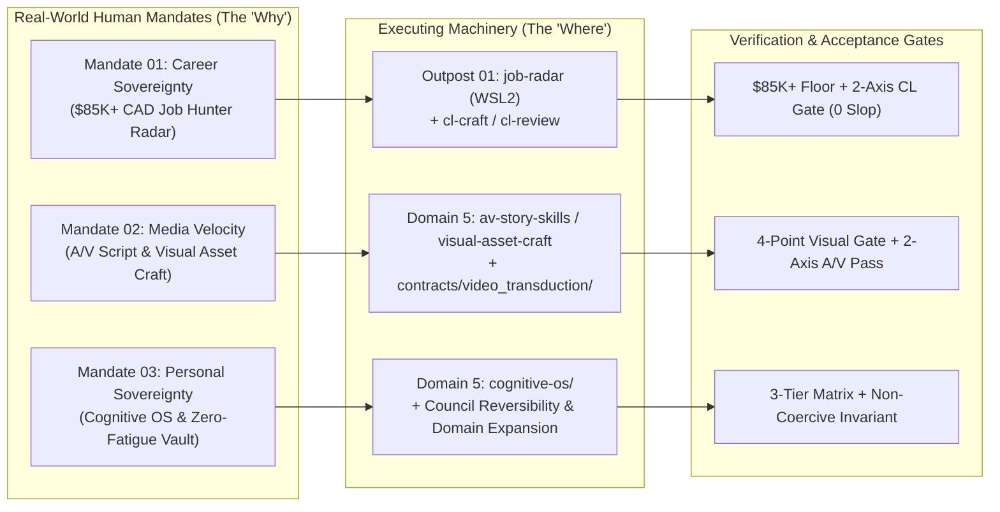
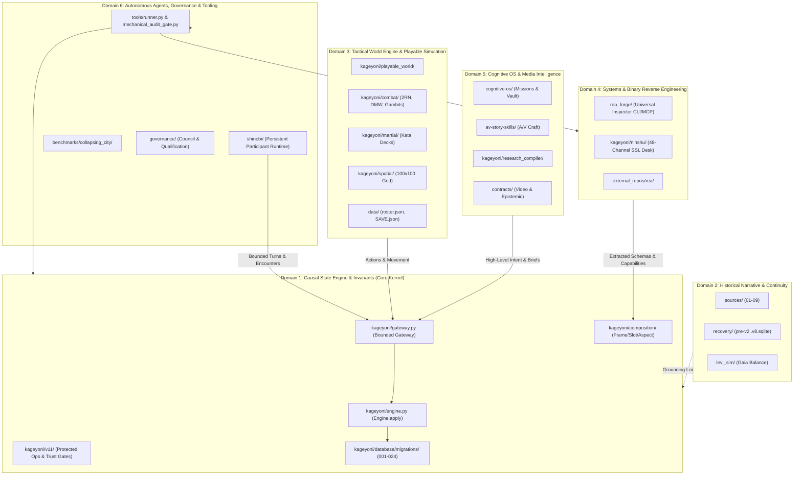
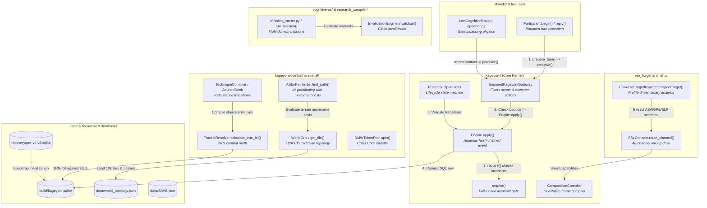
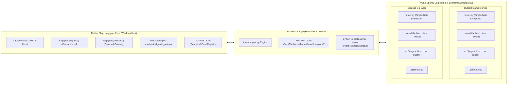

# KAGEYONI SYSTEM ATLAS & ESTATE DIRECTORY
**The Universal Front Door, Architectural Topology & Domain Fences**

> [!IMPORTANT]
> **MANDATORY DIRECTIVE FOR ALL AGENTS AND DEVELOPERS**:
> **DO NOT BEGIN A SPRINT OR EDIT CODE WITHOUT READING THIS ATLAS.**
> This repository is not an isolated tactical RPG, nor a standalone reverse engineering toolkit, nor a generic agent harness. It is an interconnected 6-domain computational estate.
> Before proposing a plan or modifying a file, identify your operational domain, verify its boundary fences, and check its relationship to the other 5 domains.

---

## 0. Sovereign Human Mandates (The "Why" Behind the Estate)

> [!NOTE]
> **The Sovereign Intent Alignment**: 
> Code, modules, ASTs, and database migrations are machinery; they exist solely to serve the human creator's sovereign life goals. Kageyōni and its downstream outpost fleet are chartered to execute three non-negotiable human mandates derived from authentic priorities:



### Mandate 01: Job Hunter Radar & Career Sovereignty
* **Real-World Target**: Secure engineering roles meeting or exceeding the **$85K+ CAD compensation floor** through high-signal market intelligence, automated scraping, algorithmic role matching, and tailored application dispatch—eliminating job board drudgery and recruiter fatigue.
* **Responsible Subsystems**:
  - Outpost 01: `outposts/job-radar/` (Sandboxed WSL2 Ubuntu fleet runtime).
  - Application Craft: `cl-craft` (Hiring Manager 20-second triage mechanics, selection regime calibration, 4-sentence transduction).
  - Review Gate: `cl-review` (2-axis parallel review: scan/slop audit + mandate/proof custody).
  - Outpost Orchestration: `outpost-workflow` (Isolated WSL2 outpost execution without core pollution).
* **Success Metric & Verification Gate**:
  - **Compensation Gate**: Strict filter rejecting any listing `< $85K CAD` (or remote equivalent).
  - **Craft Gate**: Cover letters scored against the 12 LLM anti-smells; zero generic AI boilerplate permitted.
  - **Outpost Cleanliness**: Sandboxed in WSL2 virtualenv; probe verified via `wsl python3 -m job_radar.probe`.

### Mandate 02: Visual Asset Craft & A/V Media Production
* **Real-World Target**: Empower sovereign independent filmmaking and video essay velocity—from documentary pre-shoot treatments and paper edits to deterministic programmatic overlays (PNG/SVG graphics, title cards, motion overlays) and ArtCraft-style scene blocking, without LLM print-prose drift or visual slop.
* **Responsible Subsystems**:
  - Visual Craft: `visual-asset-craft` (Deterministic programmatic overlay rendering, diffusion scene direction, video frame extraction).
  - A/V Screenwriting: `av-scriptwriting` (Dual-channel visual-first subtraction, print-to-speech mouth-shape pass, table structures).
  - Media Review: `av-review` (2-axis parallel review: craft smells vs. quarry brief and fact custody).
  - Media Contracts: `contracts/video_transduction/` and Domain 5 (`kageyoni/research_compiler/`).
* **Success Metric & Verification Gate**:
  - **Perceptual 4-Point Visual Gate**: Strict verification of Hierarchy/Contrast, Zero Clipping, Affordance, and Anti-Slop Craft (zero generic AI purple/blue gradients or floating card clichés).
  - **Spoken-Ear Audio Pass**: Scripts must pass phonetic mouth-shape read-aloud testing; reject LLM print-prose syntax.
  - **Deterministic Asset Custody**: Rendered graphic assets must compile to exact target aspect ratios and alpha-channel specifications with verified file hashes.

### Mandate 03: Cognitive OS & Personal Sovereignty
* **Real-World Target**: Maintain an authoritative, permanent personal knowledge vault and high-agency operational cockpit that protects the user's thermodynamic cognitive energy, eliminates authorization fatigue, preserves non-coercive agency, and enables continuous cross-agent reasoning.
* **Responsible Subsystems**:
  - Knowledge Architecture: `cognitive-os/` (Missions, vaults, collaborator-model authority tiers).
  - Governance & Reversibility: `council-reversibility-agent` (3-Tier Reversibility Matrix: autonomous Tier 0, gated Tier 1/2).
  - Domain Expansion: `domain-expansion` (Decoupled generative ideation from irreversible execution).
  - Foundational Law: Core physical invariant from Gaia arc: *"No Will may completely suppress another Will."*
* **Success Metric & Verification Gate**:
  - **Authorization Fatigue Elimination**: 100% of non-destructive local actions (inspections, tests, worktree branches) execute without annoying confirmation prompts.
  - **Sovereign Checkpoint Gate**: Irreversible actions (remote git pushes, external financial/cloud mutations, file deletions) strictly gate with explicit cryptographic/human approval.
  - **Fresh-Process Continuity**: Knowledge artifacts and SQLite registries remain recoverable across reboots and fresh agent threads without semantic drift.

---

## 1. Executive Topology: The 6 Sovereign Domains

Kageyoni reconciles six distinct, interdependent architectural layers. Each domain possesses dedicated responsibilities, entry points, and strict boundary invariants:



---

## 2. The 6 Domains: Purpose, Seams & Invariants

### Domain 1: Causal State Engine & Invariants (The Core Kernel)
* **Location**: [`kageyoni/engine.py`](file:///C:/Kageyoni/kageyoni/engine.py), [`kageyoni/model.py`](file:///C:/Kageyoni/kageyoni/model.py), [`kageyoni/composition/`](file:///C:/Kageyoni/kageyoni/composition/), [`kageyoni/v11/`](file:///C:/Kageyoni/kageyoni/v11/), [`kageyoni/database/`](file:///C:/Kageyoni/kageyoni/database/), [`kageyoni/gateway.py`](file:///C:/Kageyoni/kageyoni/gateway.py)
* **Purpose**: The immutable heartbeat of Kageyoni. Manages the cryptographically hashed event store, revision tracking, 24 numbered SQLite migrations, the Frame/Slot/Aspect qualitative composition compiler (V10 ontology), and V11 Protected Operations (`DECLARED` $\to$ `PREPARED` $\to$ `ASSESSED` $\to$ `AUTHORIZED` $\to$ `COMPLETED`).
* **Primary Entrypoints**:
  - Verification: `python -m tools.runner --list` or `python -m kageyoni verify`
  - Engine Operations: `python -m kageyoni operate --input command.json`
  - Gateway: `BoundedKageyoniGateway` in [`kageyoni/gateway.py`](file:///C:/Kageyoni/kageyoni/gateway.py)
* **Boundary Invariants**:
  - **Zero Direct SQLite Mutation**: Never execute `INSERT/UPDATE/DELETE` on world tables outside of `Engine.apply()`.
  - **Fail-Closed Compilation**: Missing causal prerequisites, ontology gaps, or authority violations must reject explicitly.

---

### Domain 2: Historical Narrative Continuity & Canonical Worlds (The Canon & Memory)
* **Location**: [`sources/`](file:///C:/Kageyoni/sources/), [`recovery/`](file:///C:/Kageyoni/recovery/), [`levi_sim/`](file:///C:/Kageyoni/levi_sim/), [`fixtures/historical/`](file:///C:/Kageyoni/fixtures/historical/)
* **Purpose**: Authoritative historical grounding across four major canonical campaigns:
  1. **First World & Booderland**: Alexandra's identity (age 25), her Sovereign Crew, Booder's Will, her living blade, and non-coercive sovereignty.
  2. **Gaia**: Levi, Cloud, Kenway, Erosion, Mugen Furyoku, and the core physical law: *"No Will may completely suppress another Will inside Gaia."*
  3. **Ichimonji**: Archival reification world, Xandra of Ichimonji (distinct from Xandra of Gaia), Kurogane, Sebastian, Zoro.
  4. **Later Ensemble**: Sciel, Lucretia, Ariane, Voss, Paintress domain.
* **Primary Entrypoints**:
  - Canon Bible: [`sources/01-KAGEYONI_GAIA_ARC_CONTINUITY.md`](file:///C:/Kageyoni/sources/01-KAGEYONI_GAIA_ARC_CONTINUITY.md)
  - Levi Cognition & Balance Simulation: [`levi_sim/operator.py`](file:///C:/Kageyoni/levi_sim/operator.py)
  - Historical Databases: `recovery/pre-v2-methods.sqlite`, `recovery/pre-v4-v8.sqlite`
* **Boundary Invariants**:
  - **Zero Silent Retcons**: Alexandra is 25 years old (never inflate to 38). Xandra of Gaia is distinct from Xandra of Ichimonji. Lucretia Fawn is distinct from Elowise (Environmental Admiral).
  - **Historical Carrier Custody**: Never delete or overwrite the `.sqlite` databases in `recovery/` or `fixtures/`.

---

### Domain 3: Tactical World Engine & Playable Simulation (The Playable RPG)
* **Location**: [`kageyoni/playable_world/`](file:///C:/Kageyoni/kageyoni/playable_world/), [`kageyoni/combat/`](file:///C:/Kageyoni/kageyoni/combat/), [`kageyoni/martial/`](file:///C:/Kageyoni/kageyoni/martial/), [`kageyoni/spatial/`](file:///C:/Kageyoni/kageyoni/spatial/), [`kageyoni/chat_frame.py`](file:///C:/Kageyoni/kageyoni/chat_frame.py), [`kageyoni/cli.py`](file:///C:/Kageyoni/kageyoni/cli.py), [`data/`](file:///C:/Kageyoni/data/)
* **Purpose**: Discrete playable world execution. Simulates a 100x100 continent spatial grid, 2RN combat math, Crisis Core-style Digital Mind Wave (DMW), Gambits (behavioral priority trees), Kata decks (stance transitions & martial grammar), dialogue chat framing, and portable save management.
* **Primary Entrypoints**:
  - Interactive CLI Game: `python -m kageyoni.cli`
  - Playable Kernel: `kageyoni.playable_world.kernel`
  - Rules & Roster: [`data/combat_rules.json`](file:///C:/Kageyoni/data/combat_rules.json), [`data/martial_grammar.json`](file:///C:/Kageyoni/data/martial_grammar.json), [`data/roster.json`](file:///C:/Kageyoni/data/roster.json)
* **Boundary Invariants**:
  - **No Detached Shadow Tables**: The tactical layer must not create parallel un-audited tables that bypass the canonical `Engine.apply` event stream.
  - **Portable Saves**: Saved states in [`data/SAVE.json`](file:///C:/Kageyoni/data/SAVE.json) must conform strictly to schema.

---

### Domain 4: Systems & Binary Reverse Engineering (The REA Estate)
* **Location**: [`rea_forge/`](file:///C:/Kageyoni/rea_forge/), [`kageyoni/ninshu/`](file:///C:/Kageyoni/kageyoni/ninshu/), [`external_repos/rea/`](file:///C:/Kageyoni/external_repos/rea/), [`tools/mechanical_audit_gate.py`](file:///C:/Kageyoni/tools/mechanical_audit_gate.py)
* **Purpose**: Binary reverse engineering, protocol reconstruction, and capability extraction:
  - `rea_forge`: Universal Target Inspector (`UniversalTargetInspector.ts`) supporting Electron ASAR/IPC, PE/.NET, Mach-O, ELF, APK, and WASM inspection via CLI (`scripts/rea.mjs`) and MCP (`io.github.morluto/rea`).
  - `kageyoni/ninshu`: The Python Ninshū SSL 4000 Mixing Console—a 48-channel desk providing parsers (apk, asar, cdp, coredump, frida, ghidra, ida, js_ast, macho, rizin, tls, wasm), patchbay routing, dynamic capability smelting, and hardware-in-the-loop telemetry decoupling.
* **Primary Entrypoints**:
  - TypeScript Inspector Tests: `cd rea_forge; npm test` (vitest)
  - REA CLI: `node rea_forge/scripts/rea.mjs inspect <target>`
  - Ninshu Telemetry Bus & Audit: `python -m tools.runner check-hygiene` and `python tools/run_ssl_audit.py`
* **Boundary Invariants**:
  - **Non-Invasive Inspection**: Reverse engineering tools analyze binaries and emit structured artifacts/schemas; they never mutate the narrative database or alter game saves.
  - **No Duplicate Binary Readers**: All new REA targets must be added as `TargetProfile` definitions in `rea_forge/src/inspector/profiles/`, not as copy-pasted parser classes.

---

### Domain 5: Cognitive Operating System & Media Production (The Agency Engine)
* **Location**: [`cognitive-os/`](file:///C:/Kageyoni/cognitive-os/), [`av-story-skills/`](file:///C:/Kageyoni/av-story-skills/), [`contracts/`](file:///C:/Kageyoni/contracts/), [`kageyoni/research_compiler/`](file:///C:/Kageyoni/kageyoni/research_compiler/), [`external_repos/Video-House/`](file:///C:/Kageyoni/external_repos/Video-House/), [`external_repos/VoiceStudio/`](file:///C:/Kageyoni/external_repos/VoiceStudio/)
* **Purpose**: Multi-domain cognitive agency and production pipelines:
  - `cognitive-os`: Mission-runner, vault management, and domain routing (`domains/creative`, `domains/professional`, `domains/systems`) with Collaborator-Model authority tiers.
  - `av-story-skills`: Complete A/V documentary scriptwriting craft (beats, paper edits, visual-first subtraction, print-to-speech checks, and 2-axis parallel reviews).
  - `research_compiler`: 9 story archetypes, adversarial claim invalidation, and treatment generation.
  - `contracts`: Structural intelligence contracts (`video_structure_intelligence_contract.yaml`, `agency_characters.yaml`, `epistemic_ledger.py`).
* **Primary Entrypoints**:
  - Cognitive OS CLI: `python cognitive-os/scripts/cos_cli.py`
  - Mission Runner: `python cognitive-os/scripts/mission_runner.py`
  - Research Compiler: `python tools/run_research_compiler.py`
* **Boundary Invariants**:
  - **Epistemic Separation**: Observation $\neq$ Claim $\neq$ Warrant. Information enters as evidence, never unearned canonical truth.
  - **Spoken-Ear & Visual Grounding**: All script outputs must pass visual counterpoint and spoken-ear readability without robotic AI cadence.

---

### Domain 6: Autonomous Agents, Governance & Tooling (Runtime & Verification)
* **Location**: [`shinobi/`](file:///C:/Kageyoni/shinobi/), [`shinobi_agent/`](file:///C:/Kageyoni/shinobi_agent/), [`benchmarks/collapsing_city/`](file:///C:/Kageyoni/benchmarks/collapsing_city/), [`governance/`](file:///C:/Kageyoni/governance/), [`tools/`](file:///C:/Kageyoni/tools/)
* **Purpose**: Autonomous agent orchestration, long-horizon evaluation, and developer tooling:
  - `shinobi`: A persistent participant runtime anchored into Kageyoni's transactional engine (`PersistentParticipant`, `migration_024.sql`), bounded turn briefs, encounter forms, and candidate return reviews.
  - `benchmarks/collapsing_city`: Five-tier long-horizon developmental benchmark evaluating adaptation and counter-outcome learning under stress.
  - `tools/runner.py`: The single unified entry point for running audits, tests, hygiene checks, and gates across the repository.
* **Primary Entrypoints**:
  - Unified Tool CLI: `python -m tools.runner --list` or `python -m tools.runner <command>`
  - Shinobi Participant CLI: `python shinobi/shinobi.py --home shinobi/.state/alexandra inspect`
  - Mechanical Audit Gate: `python tools/mechanical_audit_gate.py`
* **Boundary Invariants**:
  - **No Synthetic Self-Certification**: Benchmarks and qualification gates must execute real assertions and report raw exit codes. In the absence of an external verifier, declare `VERIFIER_DEFICIT`.

---

## 3. "Where Does X Live?" Quick Routing Matrix

When you receive a specific task, use this matrix to jump directly to the authoritative files:

| If your task involves... | Primary Path(s) | Key Files / Commands |
|:---|:---|:---|
| **Character identity, backstory, canon** | `sources/`, `data/roster.json` | [`01-KAGEYONI_GAIA_ARC_CONTINUITY.md`](file:///C:/Kageyoni/sources/01-KAGEYONI_GAIA_ARC_CONTINUITY.md), [`roster.json`](file:///C:/Kageyoni/data/roster.json) |
| **Gaia environmental physics or Levi** | `levi_sim/`, `sources/04-environment.md` | [`levi_sim/operator.py`](file:///C:/Kageyoni/levi_sim/operator.py), [`levi_sim/cognition.py`](file:///C:/Kageyoni/levi_sim/cognition.py) |
| **Core causal state, transactions, DB events** | `kageyoni/engine.py`, `kageyoni/database/` | `Engine.apply()`, [`kageyoni/database/migrations/`](file:///C:/Kageyoni/kageyoni/database/migrations/) |
| **V10 Frames, Slots, Aspect slottables** | `kageyoni/composition/` | [`compiler.py`](file:///C:/Kageyoni/kageyoni/composition/compiler.py), [`ontology.py`](file:///C:/Kageyoni/kageyoni/composition/ontology.py) |
| **V11 Protected Operations & Trust Gates** | `kageyoni/v11/` | [`protected_operations.py`](file:///C:/Kageyoni/kageyoni/v11/protected_operations.py), [`trust_gate.py`](file:///C:/Kageyoni/kageyoni/v11/trust_gate.py) |
| **Playing or testing the RPG / Chat** | `kageyoni/cli.py`, `kageyoni/chat_frame.py` | `python -m kageyoni.cli`, [`data/SAVE.json`](file:///C:/Kageyoni/data/SAVE.json) |
| **Combat math, DMW roulette, Gambits** | `kageyoni/combat/`, `data/combat_rules.json` | [`resolver.py`](file:///C:/Kageyoni/kageyoni/combat/resolver.py), [`dmw.py`](file:///C:/Kageyoni/kageyoni/combat/dmw.py) |
| **Martial Arts, Kata decks, Stances** | `kageyoni/martial/` | [`deck.py`](file:///C:/Kageyoni/kageyoni/martial/deck.py), [`compiler.py`](file:///C:/Kageyoni/kageyoni/martial/compiler.py) |
| **Spatial map, 100x100 continent grid** | `kageyoni/spatial/` | [`grid.py`](file:///C:/Kageyoni/kageyoni/spatial/grid.py), [`pathfinding.py`](file:///C:/Kageyoni/kageyoni/spatial/pathfinding.py) |
| **Inspecting Electron apps, binaries, ASARs** | `rea_forge/` | `npm test` in `rea_forge/`, [`UniversalTargetInspector.ts`](file:///C:/Kageyoni/rea_forge/src/inspector/UniversalTargetInspector.ts) |
| **Hardware, 48-channel mixing desk, telemetry**| `kageyoni/ninshu/` | [`console.py`](file:///C:/Kageyoni/kageyoni/ninshu/console.py), [`patchbay.py`](file:///C:/Kageyoni/kageyoni/ninshu/patchbay.py) |
| **Audio-Video documentary scripts, YouTube** | `av-story-skills/`, `contracts/` | [`av-craft/SKILL.md`](file:///C:/Kageyoni/av-story-skills/skills/av-craft/SKILL.md), [`video_structure_intelligence_contract.yaml`](file:///C:/Kageyoni/contracts/video_structure_intelligence_contract.yaml) |
| **Cognitive missions & multi-domain agency** | `cognitive-os/` | [`scripts/cos_cli.py`](file:///C:/Kageyoni/cognitive-os/scripts/cos_cli.py), [`domains/`](file:///C:/Kageyoni/cognitive-os/domains/) |
| **Market demand, executive anxieties, agent capacities** | `docs/research/`, `cognitive-os/vault/` | [`AI_AGENT_CAPACITIES_LEVI_v0.7.md`](file:///c:/Kageyoni/docs/research/AI_AGENT_CAPACITIES_LEVI_v0.7.md), [`market-quarry.md`](file:///c:/Kageyoni/cognitive-os/vault/market-quarry.md), [`COGNITIVE_QUINTET_SYNTHESIS.md`](file:///c:/Kageyoni/docs/research/COGNITIVE_QUINTET_SYNTHESIS.md) |
| **Autonomous Shinobi participant state** | `shinobi/` | [`shinobi/shinobi.py`](file:///C:/Kageyoni/shinobi/shinobi.py), [`shinobi/.state/`](file:///C:/Kageyoni/shinobi/.state/) |
| **Evaluating long-horizon learning under stress**| `benchmarks/collapsing_city/` | [`runner.py`](file:///C:/Kageyoni/benchmarks/collapsing_city/runner.py), [`evaluator.py`](file:///C:/Kageyoni/benchmarks/collapsing_city/evaluator.py) |
| **Repo hygiene, code graphs, audit checks** | `tools/` | `python -m tools.runner check-hygiene`, [`code_graph.py`](file:///C:/Users/flowe/.gemini/config/scripts/code_graph.py) |
| **Downstream Outpost Fleet (WSL2 Sandboxes)**| [`OUTPOSTS.md`](file:///c:/Kageyoni/OUTPOSTS.md), `tools/outpost.py`, `/home/flowe/outposts/` | `python -m tools.runner outpost list`, `python -m tools.runner outpost test <name>` |

---

## 4. Complete Root Directory Seam Manifest

A definitive inventory of all top-level directories in `c:\Kageyoni`:

| Directory | Domain | Purpose | Primary Tech | Boundary Policy |
|:---|:---:|:---|:---:|:---|
| `.agents/` | D6 | Agent skill definitions and host configurations | Markdown/YAML | Read-only agent instructions |
| `.github/` | D6 | CI workflows and automated test actions | YAML | Standard CI configuration |
| `av-story-skills/` | D5 | Audio-Video documentary & scriptwriting craft skills | Markdown/Python | Craft guidelines & review rubrics |
| `benchmarks/` | D6 | Empirical evaluation suites (`collapsing_city`) | Python | Zero deterministic mock rigging |
| `build/` | D1 | Ephemeral database outputs (`kageyoni.sqlite`) | SQLite/Cache | Disposable; never commit to git |
| `cognitive-os/` | D5 | Multi-domain Cognitive Operating System | Python/Markdown | Isolated vault and mission execution |
| `contracts/` | D5/D1 | Structural intelligence & communication contracts | YAML/Python | Schema and protocol invariants |
| `data/` | D3 | Static game data, roster, rules, topology, SAVE | JSON | Governed by schema; preserve identity |
| `dist/` | D1 | Built Python distribution wheels | Package | Generated by build; do not edit |
| `docs/` | Cross | Architectural blueprints, research, and history | Markdown | Living documentation |
| `evidence/` | D6 | Qualification receipts, test hashes, audit logs | JSON/MD | Append-only evidence custody |
| `examples/` | D1 | Code and JSON invocation examples | Python/JSON | Illustrative snippets |
| `experiments/` | Cross | Research prototypes (r5, r6) | Python | Isolated experimental sandboxes |
| `external_repos/` | Cross | Upstream reference codebases (`rea`, `Video-House`) | Mixed | Vendor trees; do not casually mutate |
| `fixtures/` | D2 | Historical carrier databases for regression tests | SQLite | Immutable test fixtures |
| `governance/` | D6 | Council policies, qualification gates, and hooks | Python/JSON | Reversibility and safety enforcement |
| `kageyoni/` | D1/D3/D4 | The primary Python package (Core, RPG, Ninshu) | Python | Core source code; strict reviews |
| `levi_sim/` | D2 | Levi cognitive operator & Gaia balancing simulation | Python | Epistemic firewall; Gaia physics |
| `node_modules/` | D4 | Node dependencies for `rea_forge` | JS/TS | Ignored by git |
| `patches/` | Cross | Git patches and delta archives | Diffs | Cold storage |
| `portfolio-site/` | Misc | External portfolio project (unindexed) | Web | Excluded from Kageyoni core |
| `rea_forge/` | D4 | Universal Target Inspector & REA agent engine | TypeScript | Vitest covered; CLI + MCP server |
| `recovery/` | D2 | Historical SQLite databases from earlier eras | SQLite | Read-only historical continuity |
| `schemas/` | D1 | Schema definitions (will, events, frames) | JSON/SQL | Schema validation source |
| `scripts/` | D1/D6 | Operational maintenance and preflight scripts | Python | Scripted operational utilities |
| `shinobi/` | D6 | Persistent participant runtime & encounter states | Python | Migration 024 anchored participant |
| `shinobi_agent/` | D6 | Agent packaging and form representations | JSON/Python | Participant forms |
| `skills/` | D6 | Workspace-level agent skills | Markdown | Agent skill registry |
| `sources/` | D2 | Canonical narrative records (`01` through `09`) | Markdown/SQL | Absolute canon; zero retcons |
| `state/` | D6 | Benchmark runs and cached state snapshots | JSON/Data | Runtime cache |
| `temp_agent_governing_files/`| D6 | Temporary test hooks & guards snapshot | JS/Config | Monitored by test guards; do not drop |
| `tests/` | Cross | Master pytest test suite | Python | All tests must pass before commit |
| `tools/` | D6 | Unified runner, audit gates, hygiene monitors | Python | Tool entrypoints (`python -m tools.runner`)|

### Deep Subpackage Map: Inside `kageyoni/` (All 21 Subpackages)

The core `kageyoni` Python library is organized into 21 specialized subpackages:

| Subpackage | Primary Responsibility | Key Files |
|:---|:---|:---|
| [`kageyoni/combat/`](file:///C:/Kageyoni/kageyoni/combat/) | 2RN combat calculations, Crisis Core DMW roulette, Gambits priority AI | [`resolver.py`](file:///C:/Kageyoni/kageyoni/combat/resolver.py), [`dmw.py`](file:///C:/Kageyoni/kageyoni/combat/dmw.py), [`gambits.py`](file:///C:/Kageyoni/kageyoni/combat/gambits.py) |
| [`kageyoni/composition/`](file:///C:/Kageyoni/kageyoni/composition/) | Frame/Slot/Aspect ontology, fail-closed qualitative compiler, explicit deficits | [`compiler.py`](file:///C:/Kageyoni/kageyoni/composition/compiler.py), [`ontology.py`](file:///C:/Kageyoni/kageyoni/composition/ontology.py) |
| [`kageyoni/database/`](file:///C:/Kageyoni/kageyoni/database/) | Connection pool, schema initialization, 24 numbered migrations | [`connection.py`](file:///C:/Kageyoni/kageyoni/database/connection.py), [`migrations/`](file:///C:/Kageyoni/kageyoni/database/migrations/) |
| [`kageyoni/developmental/`](file:///C:/Kageyoni/kageyoni/developmental/) | Situated participant evolution, compounding agents, symbiogenesis | [`agent.py`](file:///C:/Kageyoni/kageyoni/developmental/agent.py), [`symbiogenesis.py`](file:///C:/Kageyoni/kageyoni/developmental/symbiogenesis.py) |
| [`kageyoni/emergence/`](file:///C:/Kageyoni/kageyoni/emergence/) | Dynamic technique discovery, causal encounters, action dispatching | [`action_dispatcher.py`](file:///C:/Kageyoni/kageyoni/emergence/action_dispatcher.py), [`causal_encounter.py`](file:///C:/Kageyoni/kageyoni/emergence/causal_encounter.py) |
| [`kageyoni/entity/`](file:///C:/Kageyoni/kageyoni/entity/) | Entity component instances, specifications, runtime state | [`instance.py`](file:///C:/Kageyoni/kageyoni/entity/instance.py), [`models.py`](file:///C:/Kageyoni/kageyoni/entity/models.py) |
| [`kageyoni/execution/`](file:///C:/Kageyoni/kageyoni/execution/) | Transactional command execution and manual override operations | [`operations.py`](file:///C:/Kageyoni/kageyoni/execution/operations.py) |
| [`kageyoni/intelligence/`](file:///C:/Kageyoni/kageyoni/intelligence/) | Empirical methods ledger, learning contracts, cross-session transfer | [`learning.py`](file:///C:/Kageyoni/kageyoni/intelligence/learning.py), [`methods.py`](file:///C:/Kageyoni/kageyoni/intelligence/methods.py) |
| [`kageyoni/martial/`](file:///C:/Kageyoni/kageyoni/martial/) | Kata deck, stance transitions, martial grammar compilation, satori | [`deck.py`](file:///C:/Kageyoni/kageyoni/martial/deck.py), [`compiler.py`](file:///C:/Kageyoni/kageyoni/martial/compiler.py) |
| [`kageyoni/narrative/`](file:///C:/Kageyoni/kageyoni/narrative/) | Enton cataclysmic rupture & glassing, anti-slop filters, PA bridge | [`enton.py`](file:///C:/Kageyoni/kageyoni/narrative/enton.py), [`anti_slop.py`](file:///C:/Kageyoni/kageyoni/narrative/anti_slop.py) |
| [`kageyoni/nature/`](file:///C:/Kageyoni/kageyoni/nature/) | Environmental forces, sovereign incarnation, elemental grounding | [`grounding.py`](file:///C:/Kageyoni/kageyoni/nature/grounding.py), [`sovereign_incarnation.py`](file:///C:/Kageyoni/kageyoni/nature/sovereign_incarnation.py) |
| [`kageyoni/ninshu/`](file:///C:/Kageyoni/kageyoni/ninshu/) | 48-channel SSL mixing console, binary parsers, telemetry decoupler | [`console.py`](file:///C:/Kageyoni/kageyoni/ninshu/console.py), [`patchbay.py`](file:///C:/Kageyoni/kageyoni/ninshu/patchbay.py) |
| [`kageyoni/persistence/`](file:///C:/Kageyoni/kageyoni/persistence/) | State saving, SQLite snapshots, Unit of Work | [`unit_of_work.py`](file:///C:/Kageyoni/kageyoni/persistence/unit_of_work.py) |
| [`kageyoni/playable_world/`](file:///C:/Kageyoni/kageyoni/playable_world/) | Persistent playable situation kernel, portable save states | [`kernel.py`](file:///C:/Kageyoni/kageyoni/playable_world/kernel.py) |
| [`kageyoni/processes/`](file:///C:/Kageyoni/kageyoni/processes/) | Workflow processes and operational outcomes | [`outcomes.py`](file:///C:/Kageyoni/kageyoni/processes/outcomes.py) |
| [`kageyoni/research_compiler/`](file:///C:/Kageyoni/kageyoni/research_compiler/) | 9 story archetypes, adversarial claim invalidation, treatments | [`claims.py`](file:///C:/Kageyoni/kageyoni/research_compiler/claims.py), [`invalidation_engine.py`](file:///C:/Kageyoni/kageyoni/research_compiler/invalidation_engine.py) |
| [`kageyoni/situations/`](file:///C:/Kageyoni/kageyoni/situations/) | Situation lifecycle, long-horizon evaluation, scars, comparative trials | [`service.py`](file:///C:/Kageyoni/kageyoni/situations/service.py), [`runtime.py`](file:///C:/Kageyoni/kageyoni/situations/runtime.py) |
| [`kageyoni/spatial/`](file:///C:/Kageyoni/kageyoni/spatial/) | 100x100 continent grid, A* pathfinding, supply decay, kalpa cycle | [`grid.py`](file:///C:/Kageyoni/kageyoni/spatial/grid.py), [`pathfinding.py`](file:///C:/Kageyoni/kageyoni/spatial/pathfinding.py) |
| [`kageyoni/v11/`](file:///C:/Kageyoni/kageyoni/v11/) | Causal invariants, Protected Operations, Warrants, Trust Gates | [`protected_operations.py`](file:///C:/Kageyoni/kageyoni/v11/protected_operations.py), [`trust_gate.py`](file:///C:/Kageyoni/kageyoni/v11/trust_gate.py) |
| [`kageyoni/vantage/`](file:///C:/Kageyoni/kageyoni/vantage/) | Observer perspective, qualification rubrics, fog-of-war | [`engine.py`](file:///C:/Kageyoni/kageyoni/vantage/engine.py), [`rubric.py`](file:///C:/Kageyoni/kageyoni/vantage/rubric.py) |
| [`kageyoni/workspaces/`](file:///C:/Kageyoni/kageyoni/workspaces/) | Sandboxed subagent pipelines, workspace registries | [`pipeline.py`](file:///C:/Kageyoni/kageyoni/workspaces/pipeline.py), [`registry.py`](file:///C:/Kageyoni/kageyoni/workspaces/registry.py) |

#### Core Root Modules in `kageyoni/`
* [`kageyoni/engine.py`](file:///C:/Kageyoni/kageyoni/engine.py): Causal event application (`Engine.apply`), hash chains, revisions.
* [`kageyoni/gateway.py`](file:///C:/Kageyoni/kageyoni/gateway.py): `BoundedKageyoniGateway` (Anti-omniscience, dynamic discovery, authority checks).
* [`kageyoni/model.py`](file:///C:/Kageyoni/kageyoni/model.py): Core data models (`World`, `Entity`, `Aspect`, `Event`, `Revision`).
* [`kageyoni/chat_frame.py`](file:///C:/Kageyoni/kageyoni/chat_frame.py): Dual-runner conversational and encounter interface.
* [`kageyoni/cli.py`](file:///C:/Kageyoni/kageyoni/cli.py): Master CLI game loop.
* [`kageyoni/characters.py`](file:///C:/Kageyoni/kageyoni/characters.py) & [`will.py`](file:///C:/Kageyoni/kageyoni/will.py): Character agency, drive matrices, Will dynamics.
* [`kageyoni/participant_kernel.py`](file:///C:/Kageyoni/kageyoni/participant_kernel.py): Situated participant developmental kernel.

---

## 5. The Authoritative Location & Spatial Registry

All locations accessible across Kageyoni operate on two synchronized planes: the **In-World Spatial/Narrative Plane** and the **Software/Operational Execution Plane**.

### Plane A: In-World Narrative Worlds, Provinces & Battlefields

These locations are physically present in the engine records, recovery databases, and topological world grids:

| Location ID | Name / Description | Kind / Type | Current State / Active Rules | Canonical Source Carrier |
|:---|:---|:---|:---|:---|
| `gaia` | **Gaia** | `island` | Adaptive environmental physics (Mugen Furyoku merger). Current occupants: Levi, Xandra, Cloud, Environmental Admiral, unconscious Time Admiral. Balancing law active: *"No Will may completely suppress another Will."* | `recovery/pre-v4-v8.sqlite`, [`sources/01-...`](sources/01-KAGEYONI_GAIA_ARC_CONTINUITY.md) |
| `ichimonji` | **Ichimonji** | `world` | Archival and reification-based world. Home to Xandra of Ichimonji (distinct identity), Zoro, Sebastian, Kurogane. | `recovery/pre-v4-v8.sqlite`, `sources/03-history.md` |
| `booderland` | **Booderland** | `world` | Alexandra's origins, Sovereign Crew allegiance, Booder's Will, and non-coercive sovereignty. | `recovery/pre-v4-v8.sqlite`, `sources/01-...` |
| `first-world` | **First World** | `layer` | Deeper metaphysical layer. Round zero initialized. Unstable cuts; *"something below is writing back."* | `recovery/pre-v4-v8.sqlite`, `sources/01-...` |
| `threshold` | **First World Threshold** | `region` / `scene` | First World doorway (`threshold-scene`). Active scene in [`data/SAVE.json`](data/SAVE.json). Active round 0 initialization. | `recovery/pre-v4-v8.sqlite`, [`data/SAVE.json`](data/SAVE.json) |
| `voss-battlefield`| **Current Voss Encounter Battlefield** | `battlefield` | Active domain (`sciel-domain-proposal`): Alexandra established safe-disengagement terms protecting Sciel without captivity. Voss operatives A & B disengaging. | `recovery/pre-v4-v8.sqlite` |
| `loc_g7_chamber` | **G-7 Subterranean Chamber** | `room` | Domain of the Painteress - Voss Aftermath (`scene_painteress_chamber`). Anchored in live character state. | `shinobi/.state/characters/{alexandra,sciel,sebastian}/` |
| `chamber-threshold`| **Threshold Chamber** | `room` | The Binary Choice construct chamber with active countdown clock (`scene-binary-threshold`). | `state/levi_sim_world.sqlite` |
| `deitys-revenge` | **The Deity's Revenge** | `ship` | Sovereign warship Kenway sailed away from Gaia aboard. Kenway is physically off-island; Axiom is hidden aboard. | `recovery/pre-v4-v8.sqlite`, [`sources/01-...`](sources/01-KAGEYONI_GAIA_ARC_CONTINUITY.md) |
| `external-dark` | **External Dark** | `layer` | Metaphysical void beyond the established world layers. | `recovery/pre-v4-v8.sqlite` |

#### The 100x100 Continental Grid (Tactical World Engine)
Constructed by `kageyoni.spatial.grid.WorldGrid` from [`data/world_topology.json`](data/world_topology.json) (10,000 tiles, [0..99] x [0..99], Centroid [49.5, 49.5]):

* **Zone 1: Outer Rim (8 Starter Provinces)**:
  1. `Frostfall Highlands` (Anchor: `[50, 10]`, North)
  2. `Crescent Fen` (Anchor: `[85, 15]`, Northeast)
  3. `Sunforge Steppes` (Anchor: `[90, 50]`, East)
  4. `Tidecrag Reach` (Anchor: `[85, 85]`, Southeast)
  5. `Verdant Delta` (Anchor: `[50, 90]`, South)
  6. `Ironcliffs Mesa` (Anchor: `[15, 85]`, Southwest)
  7. `Whispering Wastes` (Anchor: `[10, 50]`, West)
  8. `Shadowwood Ridge` (Anchor: `[15, 15]`, Northwest)
* **Ring 1 Barrier Passes (8 Level-1 Fortress Gates)**:
  - `Frostfall Northern Gate` (`pass_1_n`), `Crescent Northeast Defile` (`pass_1_ne`), `Sunforge Eastern Portal` (`pass_1_e`), `Tidecrag Southeast Breach` (`pass_1_se`), `Verdant Southern Fortress` (`pass_1_s`), `Ironcliffs Southwest Passage` (`pass_1_sw`), `Whispering Western Gate` (`pass_1_w`), `Shadowwood Northwest Gorge` (`pass_1_nw`).
* **Zone 2: Intermediate Marches (3 March Provinces)**:
  9. `Silver Vale` (North March)
  10. `Obsidian Expanse` (East March)
  11. `Azure Basin` (South / West March)
* **Ring 2 Barrier Passes (4 Level-2 Redoubt Bastions)**:
  - `Mid-Ring Northern Bastion` (`pass_2_n`), `Mid-Ring Eastern Redoubt` (`pass_2_e`), `Mid-Ring Southern Bulwark` (`pass_2_s`), `Mid-Ring Western Rampart` (`pass_2_w`).
* **Zone 3: Inner Core & World Spire**:
  12. `Imperial Sanctum` (Citadel ring)
  13. `World Spire Dais` (Central Core Spire, bounds `[48..51, 48..51]`)
  - Level-3 Gateways: `Sanctum North Gateway` (`pass_3_n`), `Sanctum South Gateway` (`pass_3_s`).
* **11 Terrain Types & Enton Rupture Sites**:
  Plains (`.`), Temperate Woodland (`♣`), Dense Canopy (`♠`), Rolling Hills (`∩`), High Mountain (`▲`), Mire Swamp (`~`), Shallow River (`≈`), Deep Trench (`▓`), Military Road (`=`), Fortress Pass (`#`), Citadel Wall (`█`), and **Enton Glassed Ruin (`ruin_void`, `x`)**.

---

### Plane B: Software & Operational Execution Locations

These are the active, physical execution environments, runtime surfaces, and database carriers:

| Operational Seam | Location / Path | Purpose & Access Status | Primary Tool / Command |
|:---|:---|:---|:---|
| **Unified Runner** | [`tools/runner.py`](file:///C:/Kageyoni/tools/runner.py) | Active master CLI entrypoint for 33 registered tools. | `python -m tools.runner --list` |
| **Tactical RPG CLI** | [`kageyoni/cli.py`](file:///C:/Kageyoni/kageyoni/cli.py) | Interactive tactical simulation & turn runner. | `python -m kageyoni.cli` |
| **Causal State Engine** | [`kageyoni/engine.py`](file:///C:/Kageyoni/kageyoni/engine.py) | Authoritative event stream & transaction evaluator. | `python -m kageyoni verify` |
| **Shinobi Runtime** | [`shinobi/shinobi.py`](file:///C:/Kageyoni/shinobi/shinobi.py) | Persistent participant execution loop (migration 024). | `python shinobi/shinobi.py --home <dir> inspect` |
| **Universal REA** | [`rea_forge/`](file:///C:/Kageyoni/rea_forge/) | Universal Target Inspector CLI & MCP server. | `node rea_forge/scripts/rea.mjs inspect <target>` |
| **Cognitive OS** | [`cognitive-os/`](file:///C:/Kageyoni/cognitive-os/) | Multi-domain agency CLI & mission runner. | `python cognitive-os/scripts/cos_cli.py` |
| **Levi Simulation** | [`levi_sim/operator.py`](file:///C:/Kageyoni/levi_sim/operator.py) | Bounded gateway interface to Gaia balance mechanics. | Direct Python API |
| **Live Save File** | [`data/SAVE.json`](file:///C:/Kageyoni/data/SAVE.json) | Portable JSON game save (`levi-world-001` at `threshold`). | Read/written by `kageyoni.playable_world` |
| **Participant States** | [`shinobi/.state/characters/`](file:///C:/Kageyoni/shinobi/.state/characters/) | Live databases for 9 active participants: `alexandra`, `sciel`, `sebastian`, `voss`, `arianne`, `maki`, `cl`, `elijah`, `second_queen_bleaklands`. | Direct SQLite read / Shinobi CLI |
| **WSL2 Outpost Fleet** | `/home/flowe/outposts/` (`\\wsl$\Ubuntu\home\flowe\outposts\`) | Isolated downstream Linux sandboxes (`sample-probe`, `job-radar`) bypassing core mutation. | `python -m tools.runner outpost [list/test/run/status]` |

---

## 6. Architectural Separation: Analysis & Trade-offs

A frequent question is: *"Why don't we separate all of these into independent repositories or separate packages?"*

Here is the objective engineering trade-off:

### Option A: Complete Multi-Repo Split
* **Concept**: Split into 4 separate repos: `kageyoni-engine`, `rea-forge`, `cognitive-os`, and `kageyoni-rpg`.
* **Pros**:
  - Total blast-radius isolation: A TypeScript update in `rea_forge` cannot accidentally touch Python code.
  - Smaller git clone sizes.
  - Completely independent CI pipelines and release cadences.
* **Cons & Hazards**:
  - **High Coordination Overhead**: Every cross-domain integration (e.g. Shinobi participant using Kageyoni Gateway, or Ninshu emitting capability aspects into Kageyoni composition) requires formal package releases, version pinning, and synchronization.
  - **Slow Iteration**: Debugging an end-to-end flow requires linking local editable wheels or submodules across multiple repositories.
  - **Risk of Drift**: The narrative continuity, character identity, and causal engine would drift apart across separate issue trackers.

### Option B: The Unified Modular Estate with Hard Domain Fences (Current Architecture)
* **Concept**: Maintain a unified monorepo estate, but enforce **Hard Domain Fences** and isolated subpackages with clean, typed interfaces (`BoundedKageyoniGateway`, `runner.py`, `UniversalTargetInspector`).
* **Pros**:
  - Immediate atomic verification: A change to the causal engine can be instantly tested against Shinobi, the RPG, and the migration suite in a single command.
  - Unified memory and canon: Historical continuity, character rosters, and system rules remain co-located and cross-verifiable.
  - Zero package-publishing lag during development.
* **Enforced Fences**:
  - Tools in `rea_forge/` and `external_repos/` MUST NOT import or mutate `kageyoni/database/`.
  - Tactical RPG modules in `kageyoni/combat/` MUST NOT create shadow SQLite tables; all state flows through `Engine.apply()`.
  - Cognitive OS and A/V scripts MUST treat engine records as immutable evidence via `Warrant`.

---

## 7. The Anti-Sprint Constitution for Agents

When operating in this codebase, every AI agent MUST adhere to these laws:

1. **The Orientation Mandate**: Before editing files, determine which of the 6 Domains you are operating in. Verify which files are within your operational boundary and which files are forbidden.
2. **The "Push Right" Law**: Do not churn out endless conversational updates or start manic coding sprints. Research, test, and verify autonomously, deferring human checkpoints to the far right. Deliver one decision-ready brief at the finish line.
3. **No Sprints Without Maps**: If asked to build or fix a feature, state the **5-Line Pre-Flight Contract**:
   - *Goal*: Concrete objective.
   - *Files touched*: Explicit list.
   - *Files untouched*: Explicit boundaries protected.
   - *Real-World Acceptance Check*: The exact command that proves completion.
   - *Subagent/Worktree Route*: Execution isolation strategy.
4. **Preserve Identity & Continuity**:
   - Alexandra is a 25-year-old sovereign with her crew and Booder's Will. Never age her or reduce her to generic traits.
   - Gaia's balancing law ("no Will may suppress another Will") is immutable physical law in Gaia.
   - Distinguish Xandra of Gaia from Xandra of Ichimonji; distinguish Lucretia Fawn from Elowise.
5. **Cold Verification over Synthetic Claims**:
   - Every claim of success must be backed by raw tool outputs and exit codes (`code 0`).
   - Run tests in fresh processes. Never invent test assertions or mock out broken paths to fake a pass.

---

## 8. The System Graph: Folders, Functions & Causal Edges

Every folder in Kageyoni functions as a computational **Place (Node)**, and every function call or state transition represents an **Edge**:



### Detailed Folder, Function & Edge Inventory

| Folder / Place | Core Functions & Classes | Inbound Edges ($\leftarrow$ Callers) | Outbound Edges ($\rightarrow$ Callees) | Causal Edge (Physical Mutation / Effect) |
|:---|:---|:---|:---|:---|
| [`kageyoni/`](file:///C:/Kageyoni/kageyoni/) | `Engine.apply()`<br/>`require()`<br/>`digest()` | `gateway.py`, `shinobi.py`, `v11/runtime.py`, `chat_frame.py` | `database/connection.py`, SQLite schema | Appends SHA-256 hashed row to `events`, increments revision counter, rejects invalid invariants fail-closed. |
| [`kageyoni/gateway.py`](file:///C:/Kageyoni/kageyoni/gateway.py) | `BoundedKageyoniGateway.perceive()`<br/>`execute_action()`<br/>`query_record()` | `shinobi/shinobi.py`, `levi_sim/operator.py` | `kageyoni.engine.Engine.apply()`, `workflows.py` | Anti-omniscience boundary; filters records to avatar visibility scope; converts raw agent intent into audited `Engine.apply` events. |
| [`kageyoni/v11/`](file:///C:/Kageyoni/kageyoni/v11/) | `ProtectedOperations.declare()`<br/>`authorize()`<br/>`complete()`<br/>`Warrant.bind()` | `tools/run_gated_repairs.py`, release gates | `kageyoni.engine.Engine`, `enforcement.py` | State machine governing protected transitions (`DECLARED` $\to$ `PREPARED` $\to$ `ASSESSED` $\to$ `AUTHORIZED` $\to$ `COMPLETED`). |
| [`kageyoni/composition/`](file:///C:/Kageyoni/kageyoni/composition/) | `Compiler.compile()`<br/>`EffectResolver.resolve()` | `KAGEYONI.md` simulation commands, `service.py` | `engine_aspects.py`, `ontology.py` | Fail-closed Frame/Slot/Aspect compilation. Preserves opposing pressures in qualitative effects without averaging them away. |
| [`kageyoni/spatial/`](file:///C:/Kageyoni/kageyoni/spatial/) | `WorldGrid.get_tile()`<br/>`AStarPathfinder.find_path()`<br/>`SupplyEngine.decay_supply()` | `kageyoni/cli.py`, `chat_frame.py` | `data/world_topology.json` | Computes Manhattan/Euclidean distances across 10,000 tiles; tests pass gate unseal status; tracks Kalpa saturation. |
| [`kageyoni/combat/`](file:///C:/Kageyoni/kageyoni/combat/) | `TrueHitResolver.calculate_true_hit()`<br/>`DMWTokenPool.spin()`<br/>`PreCognitiveGambitEngine.evaluate()` | `kageyoni/cli.py`, encounter triggers | `data/combat_rules.json` | 2RN probability distribution ($(\text{roll}_1 + \text{roll}_2)/2$); evaluates Gambit priorities; mutates combatant HP and status. |
| [`kageyoni/martial/`](file:///C:/Kageyoni/kageyoni/martial/) | `TechniqueCompiler.compile()`<br/>`KataForge.forge_deck()`<br/>`AttunedDeck.draw()` | `combat/resolver.py`, `cli.py` | `data/martial_grammar.json` | Compiles combinations of Stance, Intent, Vector, and Infusion primitives into executable martial actions. |
| [`kageyoni/narrative/`](file:///C:/Kageyoni/kageyoni/narrative/) | `EntonRuptureEngine.evaluate()`<br/>`anti_slop.filter()` | `spatial/grid.py`, `chat_frame.py` | `spatial/grid.py` (`WorldTile.is_glassed_ruin`) | When stress exceeds $(18 + 12 \times \text{prior})$, triggers regional glassing lockout and mutates tile terrain to `RUIN_VOID`. |
| [`shinobi/`](file:///C:/Kageyoni/shinobi/) | `Participant.init()`<br/>`begin()`<br/>`reply()`<br/>`inspect()` | Shinobi CLI, subagent runners | `kageyoni.gateway.BoundedKageyoniGateway`, `shinobi/.state/` | Bounded turn lifecycle; commits turns to `dialogue_turn`; anchors participant returns into `migration_024.sql`. |
| [`rea_forge/`](file:///C:/Kageyoni/rea_forge/) | `UniversalTargetInspector.inspectTarget()`<br/>`loadTargetProfile()` | `scripts/rea.mjs`, MCP server | Target binary (ASAR, PE, ELF, Mach-O) | Non-invasive binary static analysis; extracts AST symbols, IPC channels, and metadata profiles into JSON receipts. |
| [`kageyoni/ninshu/`](file:///C:/Kageyoni/ninshu/) | `SSLConsole.route_channel()`<br/>`Patchbay.patch()`<br/>`TelemetryDecoupler.decouple()` | `tools/run_ssl_audit.py`, `tools/runner.py` | `ninshu_codex.sqlite`, foreign processes | 48-channel mixing desk; intercepts and isolates foreign binary telemetry; routes extracted capabilities to Frame aspects. |
| [`cognitive-os/`](file:///C:/Kageyoni/cognitive-os/) | `mission_runner.run_mission()`<br/>`cos_cli.main()` | Cognitive OS CLI, collaborator agents | `cognitive-os/vault/`, `contracts/` | Executes structured missions across `creative`, `professional`, and `systems` domains; enforces 4-tier collaborator authority. |
| [`contracts/`](file:///C:/Kageyoni/contracts/) | `EpistemicLedger.record_warrant()`<br/>`EpistemicLedger.verify_claim()` | `mission_runner.py`, `research_compiler` | `contracts/video_structure_intelligence_contract.yaml` | Separates raw observations from claims via formal Warrants; gates video and narrative claims against unverified leaks. |
| [`tools/`](file:///C:/Kageyoni/tools/) | `runner.main()`<br/>`mechanical_audit_gate.audit_workspace()` | Developer CLI, CI test runners | 33 tool scripts in `tools/` | Dispatches dynamic tool executions; audits zero throwaway workspace scripts; checks package/source parity. |
| [`tools/outpost.py`](file:///C:/Kageyoni/tools/outpost.py) | `cmd_create()`<br/>`cmd_list()`<br/>`cmd_test()`<br/>`cmd_run()`<br/>`cmd_status()` | `python -m tools.runner outpost`, host developer | WSL2 bash `/home/flowe/outposts/` | Manages lifecycle, isolation fences, Day-0 qualification, and UNC mirroring for downstream WSL2 outposts. |

---

## 9. The Downstream Outpost Fleet (WSL2 Ubuntu Sandboxes)

The **Downstream Outpost Fleet** resolves the negative space between Kageyōni's frozen LTS core and downstream exploratory tools, operational pipelines, and user-facing micro-applications. While the Mother Ship repository (`c:\Kageyoni`) remains locked at **v11.0 LTS** under strict qualification invariants, all new downstream development, experimental tooling, and operational satellites live in isolated **WSL2 Ubuntu Sandboxes** under `/home/flowe/outposts/`.

### 9.1 Topology: Mother Ship to Outpost Fleet

The operational bridge links the Windows host orchestration environment to native Linux runtime environments without cross-contaminating source trees, dependencies, or git histories:



### 9.2 The Outpost Architectural Contracts & Fences

Every outpost in the fleet is bounded by four structural invariants and a strict 3-tier reversibility contract:

1. **Location & Path Topology**:
   - **POSIX Path (Inside WSL2 Ubuntu)**: `/home/flowe/outposts/<name>/`
   - **Windows UNC Access Path**: `\\wsl$\Ubuntu\home\flowe\outposts\<name>`
2. **Strict Core Freeze & Isolation**:
   - **Zero Upstream Contamination**: Outposts are downstream consumers and experimental satellites. They never mutate, reformat, or pollute core Kageyōni repository files (`c:\Kageyoni`).
   - **Dedicated Linux Virtual Environments**: Each outpost contains its own `.venv/` inside WSL. Global `pip install` or workspace Python contamination is strictly forbidden.
   - **Independent Git Histories**: Outposts maintain separate version control histories, branch topologies, and dependency manifests (`pyproject.toml`).
3. **Single-Gate Entrypoint Invariant**:
   Every outpost implements a unified `runner.py` with three mandatory subcommands:
   - `python runner.py test` — Runs Day-0 smoke tests and unit test suites.
   - `python runner.py run` — Executes the 4-stage pipeline (`ingest` $\to$ `filter` $\to$ `core` $\to$ `export`).
   - `python runner.py status` — Reports runtime health, active parameters, `.state/` checkpoints, and `out/` deliverables.
4. **Host Mirroring & Bounded Automation**:
   - Host developers and CI tools interact with outposts through `tools/runner.py` without opening interactive shells:
     ```powershell
     python -m tools.runner outpost list
     python -m tools.runner outpost create <name> --mandate "<mandate>"
     python -m tools.runner outpost test <name>
     python -m tools.runner outpost run <name>
     python -m tools.runner outpost status <name>
     ```
5. **Reversibility Tiers within Outposts**:
   - **Tier 0 (Autonomous Fast Loop)**: Editing files in `src/`, running tests, executing `runner.py run`, reading `out/` artifacts.
   - **Tier 1 (Local Destructive Gate)**: Clearing `.state/` databases, purging `out/` exports, recreating `.venv/`.
   - **Tier 2 (Irreversible External Gate)**: Remote git pushes, external network API mutations with real money/credentials, or promoting qualified modules to Kageyōni core.

### 9.3 Standard Outpost Internal Directory Topology

```
/home/flowe/outposts/<name>/
├── .state/              # Local runtime state, checkpoints, SQLite caches
├── .venv/               # Isolated Linux Python virtual environment
├── config/              # Configuration files
│   └── settings.json    # Outpost runtime settings and parameters
├── out/                 # Generated deliverables, exports, and reports
│   └── .gitkeep
├── src/                 # Outpost domain code
│   ├── __init__.py      # Package root and version metadata
│   ├── ingest.py        # Input data / telemetry ingestion
│   ├── filter.py        # Boundary verification and filtering
│   ├── core.py          # Primary domain computation
│   └── export.py        # Deliverable and report serialization
├── tests/               # Test suite
│   ├── __init__.py
│   └── test_smoke.py    # Day-0 verification smoke tests
├── CHARTER.md           # Outpost system charter & operational contract
├── pyproject.toml       # Linux Python project metadata
└── runner.py            # Single-gate entrypoint CLI
```

### 9.4 Active Outpost Fleet Registry

Synchronized with [`OUTPOSTS.md`](file:///c:/Kageyoni/OUTPOSTS.md):

| Outpost Name | Created At | Primary Mandate | Status | Tests | Path (WSL) | Path (Host UNC) |
|---|---|---|---|---|---|---|
| `sample-probe` | 2026-10-27 03:44 UTC | Diagnostics & Verification (Telemetry probe and Day-0 qualification) | **ACTIVE** | **PASSED** | `/home/flowe/outposts/sample-probe` | `\\wsl$\Ubuntu\home\flowe\outposts\sample-probe` |
| `job-radar` | 2026-10-27 04:23 UTC | High-Signal $85K+ CAD Job Hunting Radar (Signal extraction, filtering & alerts) | **ACTIVE** | **PASSED (Day-0)** | `/home/flowe/outposts/job-radar` | `\\wsl$\Ubuntu\home\flowe\outposts\job-radar` |

