# Comprehensive SOP and Operating Guide for a YouTube Media Communications Strategist

## Executive summary

A media communications strategist holding degrees in **communications, marketing, business, and film** is unusually well positioned to treat YouTube not as a narrow “social media” function but as an integrated **media, audience, production, distribution, commercial, and governance system**. The University of Calgary’s current Communication and Media Studies curriculum emphasizes communicating to varied audiences, communication research methods, professional and technical communication, digital rhetoric, and visual communication; representative Canadian marketing curricula emphasize consumer behaviour, segmentation, positioning, customer journeys, branding, advertising, and marketing decision-making; AACSB’s current business-education standards emphasize strategic planning, stakeholder input, resource allocation, risk analysis, digital literacy, analytical capability, ethical judgement, innovation, and evidence-informed practice; and UBC’s Film Production BFA illustrates the film-production layer through camera, lighting, sound, editing, producing, documentary development, and collaborative filmmaking.

Because the institutions for the marketing, business, and film degrees were not specified, this report **does not assume a particular transcript or course history for those three credentials**. Instead, it uses representative official Canadian curricula and international business-education standards to identify transferable competency domains. The University of Calgary communication credential is grounded specifically in the university’s published program information.

The strongest operating model is a closed loop:

**objective → audience → content promise → creative concept → production → packaging → distribution → viewer experience → action → measurement → learning → next decision.**

The four degrees answer four different but interdependent questions:

| Discipline | Governing question in YouTube strategy | Principal contribution |
|---|---|---|
| Communications | **What does this mean, to whom, in what context, and with what reputational effect?** | Message architecture, publics/stakeholders, research, rhetoric, media literacy, trust |
| Marketing | **Which audience need or desire are we serving, and why should they choose this content?** | Segmentation, positioning, value proposition, demand, packaging, conversion |
| Business | **What outcome justifies the work, what resources are available, and how will performance and risk be governed?** | Objectives, economics, resources, process, risk, stakeholder accountability |
| Film | **How should the idea become an audiovisual experience?** | Story, directing, cinematography, sound, production, editing, visual continuity |

The strategist’s distinctive value is therefore **integration rather than accumulation of credentials**. Communications without marketing can produce meaningful work that is insufficiently discoverable. Marketing without communications can optimize clicks while eroding credibility. Business without film can optimize processes around undistinguished content. Film without business can produce excellent work whose cost, distribution, or strategic purpose is uncontrolled. The integrated role continuously reconciles all four.

For operating purposes, this report recommends five hard decision gates: **scope authorization, strategy/creative approval, shoot readiness, content lock, and publish readiness**. A sixth learning gate after publication determines whether the next iteration should alter the topic, packaging, opening, structure, CTA, distribution, or commercial model. These gates are a recommended production-control system, not requirements imposed by YouTube.

YouTube’s own current guidance reinforces several important principles. Titles and thumbnails are major pre-viewing signals; YouTube reports that 90% of its best-performing videos have custom thumbnails and advises titles that accurately represent the content. Its current native A/B testing can compare up to three titles, thumbnails, or title-thumbnail combinations and selects the winner based on watch time rather than clicks alone. Tags, by contrast, now play only a minimal discovery role except where they help account for common misspellings.

Once a viewer clicks, **retention becomes an editorial diagnostic rather than merely a score**. YouTube’s audience-retention reporting identifies the percentage still watching after the first 30 seconds and distinguishes flat segments, gradual declines, spikes, dips, and top moments. YouTube explicitly recommends investigating whether the opening fulfils the expectation established by the thumbnail and title and considering whether later top moments should occur earlier.

Accessibility and localization should be production requirements rather than late additions. YouTube supports authored captions, translated metadata, multiple audio languages and, for eligible creators, localized long-form thumbnails. W3C WCAG 2.2 requires captions for prerecorded synchronized media at Level A and audio description for relevant prerecorded video at Level AA, providing a useful accessibility standard even where a particular legal regime does not require WCAG conformance.

Finally, the strategist should operate as a **rights and trust steward**, not only a performance optimizer. Canadian fair-dealing law does not create blanket permission to use copyrighted material simply because a work is educational; YouTube copyright removals are legal processes; commercial music synchronization can require direct permission from the publisher or copyright owner; material commercial relationships should be clearly disclosed under Competition Bureau guidance; YouTube itself requires the paid-promotion setting for branded content; and realistic AI-generated or meaningfully AI-altered material requires disclosure under YouTube’s current policy.

The resulting role is best understood as **editorial strategist + audience strategist + producer + business operator + governance lead**, with responsibilities delegated where team capacity permits.

---

## Competency architecture: how the four degrees map to the role

The communications foundation is particularly relevant to YouTube because the University of Calgary program explicitly combines communication theory and media analysis with research methods, professional/technical communication, digital rhetoric, and visual communication. Those competencies translate directly into audience research, message architecture, scripting, stakeholder communication, media-context analysis, and evaluation.

Representative marketing programs add the consumer and market dimension: identifying needs, segmenting audiences, understanding customer journeys, positioning an offering, constructing a compelling value proposition, and connecting communication to behavioural outcomes. BCIT’s consumer-behaviour curriculum, for example, connects consumer analysis to segmentation, positioning, marketing communications, customer journeys, and digital influences, while Cape Breton University describes marketing education around consumer connection, branding, advertising, revenue, and market-share decisions.

The business layer supplies organizational discipline. AACSB’s current standards connect high-quality business education to strategy, stakeholder engagement, resource allocation, risk analysis, evidence-informed practice, digital capability, ethical judgement, agility, innovation, and continuous improvement. These are almost a direct specification for the non-creative half of a strategist’s YouTube remit: budgets, schedules, priorities, approval systems, risk, performance measurement, and portfolio management.

The film layer turns strategy into sensory experience. UBC’s Film Production BFA describes practical, collaborative filmmaking and coursework spanning camera operation, lighting, sound, editing, producing, documentary development, and production. Those capabilities become shot design, interview direction, visual coverage, production planning, continuity, sound capture, edit construction, pacing, and finishing.

The following matrix is an **integrated competency interpretation** of those source-grounded domains rather than a claim that every graduate of every program has identical mastery.

| YouTube responsibility | Communications contribution | Marketing contribution | Business contribution | Film contribution | Integrated strategist output |
|---|---|---|---|---|---|
| **Strategy** | Purpose, publics, message, context, reputation | Segment, need state, positioning, value proposition | Objective, priority, resources, risk, return | Format feasibility and viewer experience | Channel/content thesis tied to organizational outcome |
| **Audience research** | Qualitative/quantitative communication research; discourse and media context | Consumer behaviour, segmentation, journey, demand | Research prioritization and decision criteria | Genre literacy; observational/interview insight | Evidence-based audience hypothesis |
| **Creative development** | Rhetoric, narrative framing, clarity, tone | Audience promise, differentiation, appeal | Strategic fit and feasibility | Story, scene, character, visual language | Concept with both audience relevance and executable form |
| **Production** | Interviewing, spokesperson/message integrity, situational communication | Brand/product accuracy | Budget, schedule, procurement, risk | Camera, light, sound, directing, coverage | Controlled acquisition of everything needed for the final story |
| **Post-production** | Message coherence, factual clarity, reputational review | Proposition, brand integration, CTA | Revision control, efficiency, approval | Editing, rhythm, sound, graphics, colour | Final audiovisual experience aligned to strategy |
| **Distribution** | Channel/context fit and stakeholder messaging | Discovery, packaging, lifecycle promotion | Cadence and resource allocation | Platform-specific deliverables | Coordinated release and content-extension plan |
| **Analytics** | Interpret response and communication effect | CTR, audience behaviour, conversion hypotheses | KPI governance and investment decisions | Connect retention events to editorial choices | Diagnosis rather than dashboard reporting |
| **Monetization** | Trust, sponsorship disclosure, audience relationship | Sponsor fit, offer and conversion | Revenue model, margin, risk, portfolio economics | Production value against cost | Sustainable revenue architecture without sacrificing credibility |
| **Legal/compliance** | Ethics, public interest, reputational risk | Truthfulness and commercial disclosure | Governance, contracts, liability and escalation | Releases, music, footage and asset provenance | Rights-cleared, discloseable, auditable production |
| **Stakeholder management** | Stakeholder analysis, briefing, expectation management | Customer/brand alignment | Scope, RACI, escalation, decision rights | Crew/vendor coordination | One accountable process from mandate to learning |

This matrix also reveals why the role should not be reduced to “YouTube SEO.” YouTube itself says tags have a minimal role in discovery except for common misspellings, while its creator guidance places substantial emphasis on titles, thumbnails, descriptions, audience retention and analytics.

A more useful mental model is **four layers acting simultaneously**:

- **Communications: meaning and trust.** The strategist asks what audiences will infer, what context is required, what claims need evidence, whose perspective is represented, what language is appropriate, and what stakeholder risks are created.
- **Marketing: relevance and choice.** The strategist asks why a particular viewer should care now, what alternative content competes for attention, what promise is being made by the title/thumbnail, and what useful action follows viewing.
- **Business: allocation and accountability.** The strategist asks whether the video advances a defined objective, whether it deserves the required resources, who has authority to approve it, what risks need escalation, and what evidence would justify repeating or stopping the format.
- **Film: experience and execution.** The strategist asks how information becomes action, image, voice, sound, rhythm and sequence rather than remaining an abstract communication plan.

Three hypothetical cases illustrate the convergence.

**Case: expert/public-information explainer.** Communications leads issue framing, source credibility, plain-language translation, stakeholder sensitivities and reputational risk. Marketing identifies the audience’s actual question and packages the answer in terms the audience recognizes. Business establishes the outcome—perhaps qualified awareness or service uptake—and determines whether the production warrants a studio shoot, simple interview, or animation. Film turns an abstract explanation into a comprehensible visual progression. The resulting title is not merely “Program Update”; it promises the audience the information they came for, while the video itself precisely fulfils that promise.

**Case: sponsored product story.** Marketing identifies the target segment, use case and differentiated benefit. Business evaluates sponsor economics, deliverables and opportunity cost. Communications protects editorial credibility, verifies claims and controls disclosure. Film integrates the product into a genuine narrative rather than interrupting the video with disconnected commercial language. YouTube requires creators to flag branded content through the paid-promotion setting, and Canadian Competition Bureau guidance says material connections capable of affecting perceptions of independence should be clearly disclosed.

**Case: documentary/community profile.** Film leads character, scene, observational coverage, interview construction and emotional pacing. Communications leads consent, contextual accuracy and representation. Marketing determines which underlying human question can make the story legible to people who do not already know the subject. Business controls location, release, travel, crew, insurance and schedule exposure. The “marketing” contribution does not require sensationalizing the subject; it ensures the work gives an unfamiliar viewer a reason to enter the story.

The convergence can therefore be summarized as:

> **Communications decides what the work must responsibly mean. Marketing decides why a chosen audience would voluntarily enter it. Business decides why and how the organization should produce it. Film decides how the audience will actually experience it. YouTube strategy closes the loop with distribution and behavioural evidence.**

---

## End-to-end YouTube SOP from intake through publication and learning

The SOP below is a **recommended operating baseline** for a standard planned long-form YouTube production with no predetermined constraint on genre, budget, or team size. The exact durations should compress or expand according to complexity. A news response, Short, livestream, multi-location documentary, animation, or major commercial shoot would use the same gates but substantially different durations.

```mermaid
flowchart LR
    A[Brief intake] --> B{Scope gate}
    B -- Revise --> A
    B -- Approved --> C[Audience & topic research]
    C --> D[Creative brief / concept]
    D --> E{Strategy + creative gate}
    E -- Revise --> C
    E -- Approved --> F[Script + pre-production]
    F --> G{Shoot-readiness gate}
    G -- Not ready --> F
    G -- Ready --> H[Production]
    H --> I[Ingest + backup + assembly]
    I --> J[Rough cut]
    J --> K[Fine cut + graphics + sound]
    K --> L{Content-lock gate}
    L -- Revise --> J
    L -- Approved --> M[Thumbnail + metadata + captions + rights QC]
    M --> N{Publish-readiness gate}
    N -- Fail --> M
    N -- Pass --> O[Upload / schedule / publish]
    O --> P[Monitor launch]
    P --> Q[Retention + reach + action analysis]
    Q --> R{Learning gate}
    R --> C
```



A reasonable reference cycle is roughly **10–15 business days** for a conventional single-shoot video, but that is an operating recommendation rather than a YouTube requirement.

| Phase | Recommended elapsed time | Required output | Decision gate |
|---|---:|---|---|
| Intake and scoping | 0.5–1 day | Authorized project record | **Scope gate** |
| Research and strategy | 1–2 days | Audience/topic hypothesis and success definition | — |
| Creative development | 1 day | Approved creative brief and packaging hypothesis | **Strategy + creative gate** |
| Script/pre-production | 2–3 days | Script/run-of-show, shot plan, rights/logistics package | **Shoot-readiness gate** |
| Production | 1–2 days | Complete, verified media acquisition | — |
| Post-production | 3–5 days | Locked content master | **Content-lock gate** |
| Packaging/accessibility/upload | 1–2 days | Approved upload package | **Publish-readiness gate** |
| Launch | Publish day | Live asset and validated presentation | — |
| Analysis | +1/+2/+7/+28 days | Decision-oriented report | **Learning gate** |

### Intake and scope authorization
Every project begins with a formal record, even when the “client” is the strategist’s own organization. Capture objective, audience, requested output, mandatory claims, mandatory exclusions, stakeholder list, desired publish window, dependency dates, approvals, known rights issues, available sources, commercial relationships and what constitutes success. The strategist should reject ambiguous objectives such as “make something engaging” until they are translated into an observable communication or business purpose. That discipline is consistent with AACSB’s emphasis on strategic planning, stakeholder input, resource allocation and performance monitoring.

**Scope gate — GO only when:** the sponsor/decision owner exists; objective and audience are stated; required deliverables are known; critical timing is plausible; approval authority is known; and unresolved legal or factual dependencies are explicitly logged.

### Audience and topic research
Examine existing channel analytics, past videos on the topic, audience questions/comments, YouTube Studio research signals where available, search language, competitive framing, stakeholder interviews and relevant external evidence. Separate **observed evidence** from **audience hypotheses**. Research should end in a one-sentence viewer problem, not a pile of screenshots. YouTube specifically recommends using Analytics and audience/research information when developing titles and content ideas.

A useful strategic sentence is:
> **For [specific viewer/context], this video will help them [progress/outcome] by showing [distinctive value], so that [desired next state/action].**

### Creative development
Develop at least two materially different concepts when the decision is consequential. For each, specify content promise, narrative engine, opening, proof, visual device, likely title directions, thumbnail image opportunities, CTA and production implications. Treat the thumbnail and title as part of concept development rather than post-production decoration. YouTube advises creators to think about thumbnails during the shoot, notes that viewers commonly encounter the title and thumbnail before viewing, and stresses that the title must accurately represent the content.

**Strategy + creative gate — GO only when:** the concept serves the objective and audience; the promise can actually be fulfilled; the proposed story has enough evidence/access; title-thumbnail directions are plausible; risk is acceptable; and the cost/effort is proportionate to expected value.

### Script and pre-production
Create the script or structured beat sheet, fact-check claims, build the shot list, identify graphics/data needs, secure guests, schedule locations, prepare releases, clear or replace third-party materials, select music strategy, build call sheets, plan accessibility requirements, define data/footage management and determine what must be captured specifically for thumbnails. Music and copyright review belongs here, not after the edit; CMRRA states that synchronization licensing for copyrighted songs requires permission from the relevant publisher/copyright owner and that it no longer issues synchronization licences itself.

**Shoot-readiness gate — GO only when:** script/structure is approved; factual sources are available; talent and locations are confirmed; equipment/crew are confirmed; releases/rights strategy is viable; safety/logistics are addressed; thumbnail capture is planned; storage and backup capacity exist; and no unresolved issue could invalidate the shoot.

### Production
Record not only the literal script but the material the edit will need: clean primary takes, room tone/ambience, cutaways, transitions, reaction/observational footage, explanatory inserts, wild lines where appropriate, alternate framing and intentionally composed thumbnail stills. Log deviations from script immediately. Film-program competencies in camera operation, lighting, sound and collaborative production are especially relevant at this stage.

Before leaving a location, perform a **media completeness check**: primary audio audible; key image files open; required scenes covered; releases obtained; no critical prop/product/graphic error; thumbnail candidates captured; and cards/drives copied according to the project backup plan. “We shot it” is not equivalent to “we have a recoverable, editable production.”

### Ingest and post-production
Immediately establish a canonical project structure, verified backup and edit source. The recommended editorial sequence is:
`ingest → sync/log → assembly → rough cut → structural review → fine cut → graphics → audio mix → colour → captions/transcript → content lock → technical master`

Review the rough cut primarily for **story and argument**, not punctuation or colour. Review the fine cut for line-level clarity and craft. Mixing structural and cosmetic review in every round causes unnecessary revision churn.

YouTube’s retention model is useful even before publication: ask whether the opening delivers the promise made by the package, where viewers are likely to experience repetition, and whether the strongest material is buried. After publication, YouTube’s key-moments report distinguishes intro performance, top moments, spikes and dips and explicitly recommends considering whether later high-interest moments should be introduced earlier.

**Content-lock gate — GO only when:** factual/content approval is complete; stakeholders agree no substantive narrative changes remain; required disclosures are present or planned; graphics/data are correct; rights status is documented; and all subsequent work can legitimately be considered finishing.

### Finishing, packaging and accessibility
Export the master, verify it independently, build title/thumbnail variants, write the description, add chapters where useful, set language, create or correct captions, determine localization, add end-screen design space, and complete platform fields. YouTube recommends upload settings including progressive video and uploading at the same frame rate in which the material was recorded.

YouTube lets creators add captions during or after upload; caption files contain text and timing information and may also include positional/style information. Automatic captions should be reviewed rather than treated as authoritative because the authored words, names, technical terminology and non-speech information remain editorial responsibilities.

**Publish-readiness gate — PASS only when all five QC classes are green:**

| QC class | Minimum verification |
|---|---|
| **Editorial** | Promise fulfilled; facts/names/numbers correct; no outdated placeholders; opening, sequence and CTA intentional |
| **Technical** | Correct master; image/audio synchrony; no clipping/dropouts; loudness within target (-14 LUFS); graphics legible; correct frame/aspect treatment; playback spot-check completed |
| **Rights/compliance** | Music, footage, imagery and releases documented; sponsorship and AI flags resolved; sensitive/privacy issues cleared |
| **Accessibility/localization** | Captions reviewed; language set; meaningful non-speech audio represented; relevant visual-only information has accessible treatment; translations reviewed where used |
| **Platform/packaging** | Correct title, thumbnail, description, links, chapters, playlist/category settings, audience setting, visibility/schedule, end screens and monetization fields |

### Upload, schedule and publish
Use YouTube Studio to complete the platform fields rather than relying on an external scheduler for the final compliance review. YouTube’s current video settings include the paid-promotion field, altered/synthetic-content disclosure, language/caption information, chapters, licensing/distribution settings, category, recording data and Shorts remix options. Tags should not consume disproportionate optimization time: YouTube says they are mainly useful for common misspellings and otherwise play a minimal role in helping viewers find a video.

For branded content, the paid-promotion setting is mandatory under YouTube’s current rules and adds a disclosure label. For realistically generated or meaningfully AI-altered content, YouTube’s current upload workflow requires the corresponding AI disclosure.

### Launch verification
Immediately after publication, verify the live page on at least desktop and mobile: correct video, thumbnail, title, description, captions, links, chapters, audio, end screen, disclosures and public visibility. Do not assume successful upload means successful presentation.

### Post-publication learning
Separate diagnostics by causal layer:
`impression → click → first 30 seconds → sustained viewing → completion/next video → CTA/action → commercial outcome`

This prevents the common analytical error of blaming the video itself when the failure occurred at packaging, or changing a thumbnail when the actual problem is post-click retention. YouTube’s analytics separates reach/content performance from engagement and provides audience-retention diagnostics for precisely these different parts of the viewer journey.

| Observed pattern | Leading hypothesis | First investigation |
|---|---|---|
| Low exposure, normal response when exposed | Topic/distribution/eligibility issue | Traffic sources, topic demand, channel fit |
| Healthy impressions, weak click response | Packaging issue | Title-thumbnail proposition |
| Strong click, early retention collapse | Promise mismatch or weak opening | First 30 seconds against title/thumbnail |
| Healthy opening, mid-video dips | Structure/pacing/relevance issue | Exact dip moments and preceding content |
| Spikes | Rewatch/share/confusion/high-value moment | Identify why that specific moment differs |
| Strong watch, weak CTA action | CTA/offer/journey issue | Relevance, timing, friction, landing experience |
| Strong audience performance, poor economics | Business-model/cost issue | Revenue contribution versus production cost |

YouTube describes retention spikes as moments more viewers rewatched or shared, dips as moments viewers skipped or stopped watching, and a flat line as sustained viewing; these signals should therefore be interpreted in editorial context rather than automatically treated as “good” or “bad.”

### The RACI Model

| Workstream | Strategist | Producer/PM | Creative/Writer | Production/Post | Brand/legal owner | Channel/Analyst |
|---|---|---|---|---|---|---|
| Objective/audience | **A/R** | C | C | I | C | C |
| Creative brief | **A** | C | **R** | C | C | C |
| Budget/schedule | A | **R** | I | C | I | I |
| Pre-production | A | **R** | C | **R** | C | I |
| Shoot | A/C | R | C | **R** | I | I |
| Edit | **A** | C | C | **R** | C | I |
| Rights/compliance | A | R | C | C | **A/C when required** | I |
| Packaging | **A/R** | C | C | C | C | C |
| Upload/publish | A | C | I | I | C | **R** |
| Analytics/learning | **A** | I | C | C | I | **R** |

**A = accountable, R = responsible, C = consulted, I = informed.** In a one-person operation the same person may occupy most boxes, but the gates should remain distinct: the strategist should still perform the role change explicitly rather than letting “creator mode” silently approve “legal mode” or “publisher mode.”

---

## Universal YouTube content, packaging and distribution practices

| Area | Universal principle | Operational application |
|---|---|---|
| **Format** | Format follows viewer need and content promise | Choose Short, long-form, interview, essay, tutorial, livestream, documentary, etc. because it best delivers the intended experience |
| **Story** | Create progress, not merely information accumulation | Give viewers a question, tension, transformation, discovery or ordered task to follow |
| **Opening** | Fulfil the click promise early | Establish what the viewer is getting and why continuing matters; remove ceremonial preamble that delays value |
| **Thumbnail** | Communicate one legible idea accurately | Strong focal subject; deliberate composition; visual distinction; avoid depicting a promise the video does not fulfil |
| **Title** | Clarify or sharpen the viewer promise | Accurate, concise, strongest information early; use search-oriented or curiosity-oriented framing according to discovery context |
| **Title + thumbnail** | Design them as one system | Avoid wasting both surfaces on identical information; test materially different propositions |
| **Description** | Help people and systems understand the content | State the video's subject naturally; place genuinely useful context/links/disclosures where viewers can find them |
| **Tags** | Treat as maintenance metadata, not strategy | Add genuine alternate spellings where useful; do not spend major strategic effort on tag lists |
| **Retention** | Diagnose the viewer experience moment by moment | Compare opening, dips, spikes and top moments with the editorial timeline |
| **CTA** | Ask for the next action that logically follows the value delivered | One primary CTA; secondary actions only where they do not compete |
| **Accessibility** | Preserve meaning for viewers who cannot access one sensory channel | Accurate captions, meaningful non-speech cues, transcripts and audio description where appropriate |
| **Localization** | Localize meaning, not merely strings | Translate metadata/captions, adapt thumbnail text and dub strategically where evidence supports a language market |
| **Iteration** | Test hypotheses, not cosmetic variants | Record what changed, why, what metric it should affect, and what happened |

### Packaging & Thumbnail Wireframing

A second concept should change the **proposition**, not merely the font:

```text
Illustrative thumbnail A — human/problem framing
┌──────────────────────────────────────┐
│                                      │
│    [PRIMARY FACE / OBJECT]           │
│                                      │
│                         WHAT         │
│                         CHANGED?     │
│                                      │
└──────────────────────────────────────┘
One focal idea • minimal competing detail • readable at small size

Illustrative thumbnail B — outcome/evidence framing
┌──────────────────────────────────────┐
│                                      │
│    BEFORE          →       AFTER     │
│                                      │
│            THE RESULT               │
│                                      │
└──────────────────────────────────────┘
Shows transformation/evidence instead of reaction
```

Current YouTube Studio can A/B test as many as three titles, thumbnails, or combined title-thumbnail variants. YouTube determines the resulting winner on the basis of watch time, which is strategically important: the goal is not a thumbnail that creates the most clicks regardless of consequence, but packaging that attracts viewers who then consume the content.

### Metadata Layout

```text
TITLE
[Specific audience promise / question / outcome]

DESCRIPTION — OPENING
What this video actually covers, written naturally in the
language the intended viewer would recognize.

PRIMARY ACTION
Relevant next step / resource / destination.

CHAPTERS
00:00 Opening / question
01:12 Context
03:40 Core demonstration or argument
07:15 Result / implications
09:05 Next step

DISCLOSURES
Sponsor / affiliate / AI / material relationship disclosure
where applicable.

REFERENCES / CREDITS
Sources, guests, music/asset credits, relevant documentation.

LOCALIZATION
Translated title + description + subtitle/dub assets where justified.
```

---

## Project management, tools and KPI system

A recommended workflow state model is:
`Intake → Scoped → Research → Creative approval → Pre-production → Production → Edit → Stakeholder review → Content locked → Publish QC → Scheduled → Published → Learning complete → Archived`

A practical folder structure is equally important:

```text
/PROJECT_NAME
  /00_ADMIN
     brief
     schedule
     budget
     approvals
     releases
     rights-register
  /01_RESEARCH
     sources
     transcripts
     references
  /02_CREATIVE
     creative-brief
     script
     storyboard
     shot-list
     thumbnail-concepts
  /03_PRODUCTION
     /CAM_A
     /CAM_B
     /AUDIO
     /STILLS
     /GRAPHICS_SOURCE
  /04_POST
     /PROJECT_FILES
     /PROXIES
     /GFX
     /MUSIC_SFX
     /REVIEW_EXPORTS
  /05_MASTERS
     picture-master
     caption-files
     thumbnails
  /06_PUBLISH
     metadata
     localization
     analytics-snapshots
  /07_ARCHIVE
```

A stable filename convention prevents ambiguity:
`YYYYMMDD_Project_Asset_Descriptor_v##_[DRAFT|REVIEW|APPROVED].ext`

### Timecoded Review Convention

```text
[00:02:14:08] CATEGORY: Factual
Current: "The program launched in 2024."
Change: "The pilot launched in 2024; the full program launched in 2025."
Reason: Source confirms staged launch.
Source: [canonical research/approval reference]
Owner: Writer
Status: OPEN
```

Avoid notes such as “this part feels weird” unless the reviewer identifies the function that is failing: unclear logic, pace, tone, evidence, continuity, visual comprehension, brand alignment or factual accuracy.

### KPI Framework

| Phase | Primary KPIs | Diagnostic question | Typical decision |
|---|---|---|---|
| **Strategy** | Baseline topic/channel performance; existing audience demand signals; objective metric | Are we solving a meaningful audience problem that advances the mandate? | Proceed, change topic, narrow audience |
| **Packaging** | Impressions, CTR by relevant traffic context, native title/thumbnail test outcome | Are qualified viewers choosing the video when they encounter it? | Retest title/thumbnail |
| **Opening** | First-30-second retention; early retention curve | Did the video fulfil the package promise quickly enough? | Change future opening or promise |
| **Core viewing** | Average view duration, percentage viewed, top moments, spikes, dips | Where does perceived value increase or fall? | Restructure future episodes |
| **Distribution** | Traffic-source mix, views, audience composition, new/returning behaviour | Which distribution paths are producing useful viewers? | Reallocate promotion or format |
| **Action** | End-screen/CTA behaviour, tracked referral or organizational conversions | Did viewers take the intended next step? | Refine CTA, offer or downstream journey |
| **Community** | Relevant comments/questions, returning-viewer behaviour, subscriber change | Is the content building an ongoing audience relationship? | Develop series/community response |
| **Monetization** | Platform revenue where applicable, sponsor/affiliate/direct revenue, production cost, contribution | Is the content economically sustainable? | Scale, redesign, renegotiate or stop |
| **Learning** | Hypothesis outcomes across comparable videos | What did this production teach that changes the next decision? | Update playbook |

Cadence:
- **Launch check: immediate** (Verify technical/live-page correctness)
- **Early check: ~24 hours** (Detect obvious packaging or technical anomalies)
- **Retention check: ~48 hours** (Inspect intro/top moments/spikes/dips when data is ready)
- **Weekly check** (Assess reach, traffic sources, engagement and action)
- **~28-day review** (Make portfolio/format decisions and preserve lessons)

---

## Reusable template pack

The SOP provides ready templates for:
- **Brief intake form** (Scope gate verification)
- **Creative brief** (Strategy & Creative gate verification)
- **Shot list** (Shoot-readiness gate verification)
- **Edit-note template** (Content-lock gate verification)
- **Publish checklist** (Publish-readiness gate verification across all 5 QC classes)
- **Analytics report** (Learning gate verification)

---

## Legal, ethical and governance controls

| Risk domain | Operating rule | Evidence/control |
|---|---|---|
| Copyright | Never assume Internet availability equals permission | Rights register, licence, documented exception analysis |
| Music | Determine the rights/licence needed before edit lock | Licence terms, publisher/rightsholder permission or approved library evidence |
| Sponsorship | Identify material commercial relationships early | Contract + clear viewer disclosure + YouTube paid-promotion field |
| Advertising claims | Substantiate material factual claims | Source/evidence record |
| Privacy | Collect/use/disclose personal information only under applicable authority/consent | Consent/release and privacy review (Alberta PIPA / federal PIPEDA) |
| Likeness/interviews | Establish informed participation and intended use | Written release/consent appropriate to context |
| AI alteration | Determine whether realistic alteration/generation requires platform disclosure | Production log + YouTube AI-use field |
| Accessibility | Build accessibility assets into production | Caption/transcript/audio-description QC (WCAG 2.2 Level A/AA) |
| Sensitive subjects | Apply elevated editorial, privacy and harm review | Documented editorial/legal escalation |
| Archiving | Preserve approval and rights evidence with master | Final production archive |

The final governance model is therefore not “legal reviews creative.” It is:
> **strategy establishes the promise → research substantiates it → production acquires it lawfully → editing preserves meaning → packaging represents it honestly → publishing discloses what viewers need to know → analytics improves the next work without overriding those constraints.**
