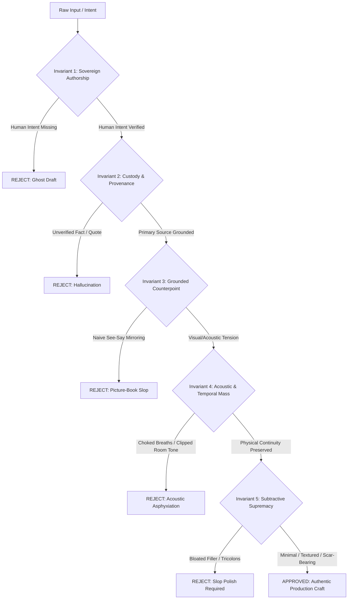

# Practitioner Backlash & Frontline Craft Friction Mining
## Forensic Quarry of Real-World AI Role Failures, The Editing Tax, and The Authenticity Deficit Across Professional Disciplines

> **Outpost Target**: `/home/flowe/outposts/role-failure-forensics/out/practitioner_friction.md`  
> **Windows UNC Mirror**: `\\wsl$\Ubuntu\home\flowe\outposts\role-failure-forensics\out\practitioner_friction.md`  
> **Investigation Date**: October 2026  
> **Frontline Sensor Data**: r/copywriting, r/editors, r/marketing, r/sysadmin, r/recruitinghell, r/MachineLearning, Hacker News, Substack post-mortems, Stanford/METR empirical developer productivity studies.  
> **Epistemic Classification**: Layer 3 Forensic Extraction (Zero Platitudes, Physical Failure Modes, Deterministic Craft Mechanics).

---

## Executive Summary & Epistemic Baseline

Over the past 36 months, the corporate narrative surrounding generative artificial intelligence (LLMs, diffusion models, automated video editors, synthetic voice platforms) has promised order-of-magnitude productivity gains: *"10x engineers," "frictionless content marketing," "autonomous video cutting,"* and *"instant high-converting copy."*

On the operational frontline, however, human practitioners—copywriters, video editors, audio engineers, systems administrators, investigative journalists, and product designers—are experiencing an acute counter-reality: **craft degradation, cognitive exhaustion, and negative return on investment (Negative ROI)**.

When practitioners declare:
> *"You can't use AI for anything. It's always wrong. It took away authenticity. Rewriting it takes twice as long as doing it myself."*

Executive management and vendor advocates frequently dismiss these complaints as reactionary Luddism, institutional inertia, or fear of technological obsolescence.

**This forensic quarry establishes the structural counter-thesis:**  
Frontline practitioner backlash is not emotional resistance; it is an **unfiltered sensor network for the physical, acoustic, and cognitive failure thresholds that generative probabilistic models mechanically violate**.

Language models and synthetic media generators optimize for *average token probability* across massive, undifferentiated corpora. Craft, by contrast, operates strictly in the extreme tails:
1. **The physical acoustics of respiration and room reflection** that pace human auditory comprehension.
2. **The cinematic counterpoint** between sound and image that generates subtext rather than redundant visual noise.
3. **The idiosyncratic syntactic syncopation** and asymmetric trade-offs of an authentic human voice.
4. **The rigid mechanical state machines** that prevent user interfaces from shattering and production servers from crashing.

When probabilistic averages are forced into high-craft workflows, they do not accelerate labor. They introduce a massive, unpriced **"Editing Tax"** (1.5x to 2x overhead compared to authoring from a blank page) and degrade junior and mid-level professionals into exhausted **"Liability Sponges"** and **"Botsitters"** babysitting statistical hallucinations.

---

## Part 1: The 10 Fatal Craft Smells of AI Generation

Every frontline creative and technical discipline has documented specific structural, acoustic, and visual failure modes where generative tools break down. Below is the diagnostic taxonomy of the **10 Fatal Craft Smells**, detailing the physical, aesthetic, and architectural mechanics behind each failure.

```
+===================================================================================================+
|                                 THE 10 FATAL CRAFT SMELLS TAXONOMY                                |
+----+----------------------------+-----------------------+-----------------------------------------+
| #  | Craft Smell                | Primary Domain        | Physical / Structural Failure Mechanism |
+----+----------------------------+-----------------------+-----------------------------------------+
| 01 | Acoustic Asphyxiation      | Audio & Video Post    | Zero-crossing breath & room-tone floor  |
|    | & Room Floor Slicing       |                       | truncation (-inf dBFS noise gating)     |
+----+----------------------------+-----------------------+-----------------------------------------+
| 02 | See-Say Mirroring          | Video Editing & B-Roll| Naive 1:1 noun-visual mapping; destroys |
|    |                            |                       | narrative counterpoint (Murch Rule 6)   |
+----+----------------------------+-----------------------+-----------------------------------------+
| 03 | Blind Performance &        | Synthetic Dubbing &   | Ocular/jaw paralysis; phoneme drift     |
|    | Viseme Drift               | Video Generation      | past 5-7s due to unanchored phase clock |
+----+----------------------------+-----------------------+-----------------------------------------+
| 04 | Symmetric Triad Compulsion | Copywriting & Prose   | Autoregressive mode collapse toward     |
|    | (Tricolon Compulsion)      |                       | three-part balanced parallel clauses    |
+----+----------------------------+-----------------------+-----------------------------------------+
| 05 | Negative Parallelism       | Marketing & Thought   | Pseudo-profound "It's not just X, it's  |
|    | (The Em-Dash Pivot)        | Leadership            | Y" antithesis without empirical tradeoffs|
+----+----------------------------+-----------------------+-----------------------------------------+
| 06 | Grandiosity Inflation &    | B2B Comms & PR        | High-frequency token crutches: "delve," |
|    | Empty Intensifier Density  |                       | "tapestry," "beacon," "testament to"    |
+----+----------------------------+-----------------------+-----------------------------------------+
| 07 | Zero Point-of-View &       | Journalism & Technical| RLHF hedging centroid; sycophantic      |
|    | Middle-Brow Sycophancy     | Strategy              | consensus smoothing; zero trade-off gut |
+----+----------------------------+-----------------------+-----------------------------------------+
| 08 | Stateless Component &      | UI/UX Design &        | Positive-space layout generation; zero  |
|    | Disconnected Div Syndrome  | Frontend Dev          | state machines (loading, error, overflow)|
+----+----------------------------+-----------------------+-----------------------------------------+
| 09 | Brittle Hallucination &    | Sysadmin & Systems    | Unconstrained statistical search space; |
|    | Package-Squatting Threat   | Engineering           | fabricated CLI flags & npm/pip vectors  |
+----+----------------------------+-----------------------+-----------------------------------------+
| 10 | Uniform Cadence &          | Editorial & Narrative | Perplexity smoothing; 18-24 word rhythm;|
|    | Burstiness Erasure         | Prose                 | total death of staccato syncopation     |
+----+----------------------------+-----------------------+-----------------------------------------+
```

---

### Smell 01: Acoustic Asphyxiation & Room Floor Slicing (Audio/Video Editing)
- **Frontline Forum Receipts**: `r/editors`, `r/podcasting` (critiques of Descript "Remove Filler / Silence," Premiere Pro Text-Based Editing auto-cut, AutoPod gap removers).
- **The Failure Mechanics**:
  Human speech is physically grounded in pulmonary respiration and laryngeal biomechanics. Prior to articulating a multi-clause sentence, a speaker executes an involuntary pre-phonemic inhalation lasting between 200ms and 600ms, followed by glottal opening. Furthermore, every physical recording space possesses an ambient reverberant noise floor (HVAC airflow, room reverberation tails, preamp thermal noise floor between -54 dBFS and -64 dBFS).
  
  Automated "silence removal" algorithms apply simplistic amplitude threshold gates (e.g. cutting any audio below -42 dBFS). When an algorithm splices directly to the initial waveform transient of an utterance, it creates two physical failure modes:
  1. **Acoustic Asphyxiation**: The speaker is presented delivering consecutive complex sentences without ever inhaling. Human mirror neurons in the auditory cortex monitor conversational respiration to gauge cognitive load and emotional state. When respiration cues are computationally erased, the listener experiences subconscious cognitive anxiety, auditory fatigue, and a sensation of manic unreality.
  2. **The Ambient Vacuum Snap**: The ambient noise floor drops instantaneously from -58 dBFS down to digital absolute zero (`-inf dBFS`), and then snaps back open 10ms later. If the cut does not occur at an exact zero-crossing point with a 5ms to 10ms equal-power crossfade, it generates audible transient DC-offset clicks and pops.
- **Concrete Example**: A corporate interview where the CEO sounds as if they are speaking from inside an anechoic vacuum chamber, choking down thoughts without taking a breath, punctuated by clicking room tone gates between every clause.

---

### Smell 02: See-Say Mirroring & The Infant Picture-Book Reflex (Video Editing & Motion)
- **Frontline Forum Receipts**: `r/editors`, `r/VideoEditors` (critiques of Opus Clip, Invideo AI, CapCut Auto B-Roll, Runway Gen-2 auto-b-roll).
- **The Failure Mechanics**:
  Cinematic grammar relies on **Dual-Channel Grounding and Dynamic Counterpoint** (formulated classically in Walter Murch's *Rule of Six* and documentary paper editing). The auditory channel and visual channel must never duplicate information identically; they must triangulate narrative meaning. The audio delivers exposition, interiority, or emotional trajectory; the visual delivers environmental context, character reaction, or subtext (`Requires -> Grounds`).
  
  Automated AI B-roll tools execute naive 1:1 lexical token matching:
  - Speaker says: *"We faced a tight deadline..."* → AI cuts to: Stock footage of an analog stopwatch or ticking wall clock.
  - Speaker says: *"Deep work requires focus..."* → AI cuts to: Macro shot of hands typing furiously on a glowing mechanical keyboard.
  - Speaker says: *"Our company achieved rapid growth..."* → AI cuts to: 3D holographic green arrow curving upward against a blue stock grid.
  
  This insults audience cognition. It treats adult viewers like toddlers reading a picture book where every spoken noun must be accompanied by a pointing finger. It creates visual clutter, destroys dramatic pacing, and signals immediately that no human mind conceived the thematic relationship between image and sound.
- **Concrete Example**: A documentary interview regarding industrial toxic waste dumping where, the moment the subject utters the word *"boardroom,"* the automated B-roll tool cuts to a glossy clip of four smiling multiracial models clinking coffee cups in a sunny glass atrium.

---

### Smell 03: The Blind Performance & Phoneme-Viseme Drift (Synthetic Dubbing & Video)
- **Frontline Forum Receipts**: `r/MachineLearning`, `r/vfx`, `r/filmmakers` (post-mortems on HeyGen, Hedra, LivePortrait, ElevenLabs video dubbing).
- **The Failure Mechanics**:
  Human phonation is an integrated whole-body motor event. When articulating a bilabial plosive (`/p/`, `/b/`) or a dental fricative (`/th/`), motor activation does not isolate the vermilion border of the lips: the mentalis tenses the chin pad, the platysma engages the cervical neck cords, the laryngeal box elevates, and the upper facial musculature (orbicularis oculi, zygomaticus major) displays emotional activation (Duchenne markers).
  
  Synthetic lip-sync systems operate via isolated 2D or 2.5D perioral mesh warping driven by acoustic wav2vec features. This produces three deterministic failure thresholds:
  1. **Upper-Face Muscular Paralysis ("The Blind Performance")**: The mouth flaps with hyper-articulated precision, but the subject's ocular region remains frozen, unblinking, or trapped in an asynchronous pseudo-random blink loop. The throat, neck tendons, and forehead show zero musculoskeletal recruitment.
  2. **Compounding Temporal Drift (The 6-Second Ceiling)**: Autoregressive diffusion and warping models process frames sequentially or in short sliding windows. Because there is no overarching biomechanical skeletal phase clock, sub-frame timing errors (10ms to 20ms) compound. By second 6 or 7, phoneme-viseme alignment decouples: plosives occur while the mouth is already relaxing, producing an eerie ventriloquist effect.
  3. **Attribute Leakage**: In multi-character or medium shots, the lip-sync bounding box leaks across faces, causing secondary background actors to subtly twitch their jaws in sympathy with the primary speaker's audio.
- **Concrete Example**: An AI-dubbed executive translation where the CEO's mouth moves to match Japanese syllables, but their teeth blur into a glistening, unsegmented calcified strip, their jaw detaches from the skull base, and their eyes stare unblinkingly into the lens like a taxidermied specimen.

---

### Smell 04: The Symmetric Triad Compulsion / Tricolon Compulsion (Copywriting & Prose)
- **Frontline Forum Receipts**: `r/copywriting`, `r/marketing`, `Hacker News`.
- **The Failure Mechanics**:
  In human prose, rhythm follows thought: some arguments require an abrupt punchline; others demand a rolling, asymmetrical balance of clauses; others require a single, heavy monosyllable.
  
  Large language models, governed by cross-entropy loss minimization and RLHF alignment, exhibit an uncontrollable statistical gravity toward **syntactic tricolons (balanced parallel sets of three)**. The model's probability distribution calculates that a three-part predicate provides the safest, most generically complete resolution to an introductory clause.
- **Concrete Example**:
  ```text
  Typical AI Output:
  "Our platform empowers teams to streamline workflows, enhance collaboration, 
  and drive measurable growth."
  
  "We are committed to delivering exceptional quality, fostering long-term partnerships, 
  and shaping the future of technology."
  
  "Discover how our tools help you save time, reduce operational costs, 
  and unlock unprecedented business potential."
  ```
  When three consecutive paragraphs conclude with three-verb, three-noun parallel triads, the text takes on the mechanical rhythm of a ticking metronome. Human readers do not read every word; their subconscious pattern recognition flags the rhythm as synthetic filler and disengages.

---

### Smell 05: Negative Parallelism & The Em-Dash Pivot (Marketing & Thought Leadership)
- **Frontline Forum Receipts**: `r/copywriting`, `r/content_marketing`, `Substack critiques`.
- **The Failure Mechanics**:
  This is the single most pervasive syntactical fingerprint of modern LLMs (GPT-4, Claude 3.5, Gemini). When prompted to write thought leadership, marketing copy, or an essay, the model routinely manufactures pseudo-depth by asserting what something is *not*, followed by an em-dash, followed by what it *is*.
- **The Formula**:
  `"[Subject] is not just about [Literal Tactical Task]—it is about [Grandiloquent Abstract Aspiration]."`
- **Concrete Example**:
  - *"Customer onboarding isn't just about sending emails—it's about orchestrating an empathetic transformation."*
  - *"Software architecture is not merely about writing clean code—it's about weaving the digital tapestry of human connection."*
  - *"Product design isn't just about pixels—it's a testament to human-centered problem-solving."*
  
  Practitioners hate this construct because it is **pure empty calories**. It provides the grammatical illusion of profundity while communicating zero operational facts, technical constraints, or concrete trade-offs. It is the rhetorical equivalent of cotton candy: voluminous, sweet, and instantly evaporating.

---

### Smell 06: Grandiosity Inflation & Empty Intensifier Density (B2B Comms & PR)
- **Frontline Forum Receipts**: `r/PR`, `r/recruitinghell`, `r/marketing`.
- **The Failure Mechanics**:
  Because LLM training corpora are heavily weighted with PR announcements, academic abstracts, and marketing hyperbole, the model learns that "important" writing is characterized by elevated, ornamental vocabulary. When human copywriters write, they rely on concrete sensory nouns and vigorous Anglo-Saxon verbs (*cut, build, split, break, drive*). LLMs reflexively substitute Latinate, high-syllable abstractions and inflated intensifiers.
- **The Banned Lexicon of AI Slop**:
  - **Nouns**: *Tapestry, realm, landscape, ecosystem, beacon, paradigm, journey, testament, synergy, symphony.*
  - **Verbs**: *Delve, harness, unlock, elevate, foster, cultivate, navigate, spearhead, illuminate.*
  - **Adjectives**: *Pivotal, multifaceted, robust, seamless, cutting-edge, vibrant, transformative, meticulous.*
- **Concrete Example**:
  *"In today's dynamic digital landscape, this groundbreaking initiative stands as a testament to our relentless pursuit of excellence, delving deep into the intricate tapestry of modern enterprise needs to unlock seamless operational synergy."*
  
  Any editor who sees the word **"delve"** or **"tapestry"** in 2026 immediately deletes the entire sentence. The vocabulary acts as a glaring neon billboard announcing that no human mind stood behind the statement.

---

### Smell 07: Zero Point-of-View & Middle-Brow Sycophancy (Journalism & Strategy)
- **Frontline Forum Receipts**: `r/MachineLearning`, `r/ExperiencedDevs`, `Substack essayists`.
- **The Failure Mechanics**:
  Reinforcement Learning from Human Feedback (RLHF) specifically penalizes language models for taking controversial, offensive, or uncompromising positions. The model is trained to be helpful, harmless, and universally agreeable.
  
  The mathematical result is **centripetal smoothing toward the middle-brow centroid**. An LLM cannot commit to an aesthetic, editorial, or technical hierarchy. When asked to evaluate an architectural decision, it presents a bland list of pros and cons, refuses to crown a victor, and ends with an equivocal corporate platitude.
- **Concrete Example**:
  *"While microservices offer unparalleled horizontal scalability and team autonomy, monolithic architectures provide simplicity, ease of debugging, and lower operational overhead. Ultimately, the optimal choice depends upon your organization's unique operational context, team composition, and long-term strategic objectives as you navigate your architectural journey."*
  
  This output is useless to a Lead Architect. It tells them what they already know, takes no professional risk, offers zero empirical heuristics, and hides from the hard realities of edge-case failure modes. It is writing without skin in the game.

---

### Smell 08: The Stateless Component & Disconnected Div Syndrome (UI/UX & Frontend)
- **Frontline Forum Receipts**: `r/UXDesign`, `r/web_design`, `r/Frontend` (critiques of v0, Figma AI, Cursor/Copilot frontend generation).
- **The Failure Mechanics**:
  Visual designers and frontend engineers judge UI components not by how they look in a static screenshot, but by how they behave across dynamic state transitions. Production UI is a finite state machine:
  `State in {Uninitialized, Loading, Empty, Populated, Partial Error, Fatal Error, Disabled}`
  
  Generative UI platforms generate purely in the **positive space of the ideal populated layout**:
  - They generate a card with hardcoded `w-[320px]` and 14px text assuming an author name of *"Jane Doe"*. When real-world data feeds a name like *"Dr. Wolfeschlegelsteinhausenbergerdorff III"*, the flex container shatters, text overflows the viewport boundary, and truncation ellipsis fails.
  - They omit focus-visible outlines, ARIA attributes, semantic landmarks (`<main>`, `<nav>`, `<article>`), and dynamic keyboard tab indexing, resulting in severe accessibility violations (WCAG 2.1 AA failures).
  - They hardcode inline hex values (`#3b82f6`) and magic padding numbers (`p-[18px]`) instead of binding to an established design token schema (`tokens.color.primary`, `tokens.spacing.md`).
- **Concrete Example**: An AI-generated analytics dashboard that looks stunning in a 1200x800 Figma mock, but immediately breaks when viewed on an ultrawide monitor, fails screen reader navigation, and drops to zero contrast when switched to dark mode.

---

### Smell 09: Brittle Hallucination & The Package-Squatting Threat (Sysadmin & DevOps)
- **Frontline Forum Receipts**: `r/sysadmin`, `r/ExperiencedDevs` (horror stories of junior admins running ChatGPT scripts).
- **The Failure Mechanics**:
  Large language models do not maintain an internal execution sandbox or formal AST compiler. They predict tokens based on syntactic plausibility. In systems administration, where command-line utilities possess thousands of esoteric parameters across different OS versions, the model will invent parameters that *sound* linguistically appropriate.
- **Concrete Example**:
  1. **Hallucinated CLI Flags**: An admin asks for a PowerShell command to audit Active Directory group membership. ChatGPT generates `Get-ADUser -Filter * -Properties LastLogonDate, NestedGroupMembership -Recursive`. The flag `-Recursive` does not exist on that cmdlet; in some toolchains, an unhandled parameter is silently ignored, causing the script to return false positives or incomplete security audits.
  2. **Package Squatting (Dependency Hallucination)**: An LLM generates a Python or Node.js solution requiring an import like `import azure_ad_token_auditor`. The package does not exist in PyPI. Malicious threat actors actively monitor common LLM package hallucinations, register those package names on PyPI/npm, and inject infostealer payloads. When an inexperienced engineer blindly runs `pip install azure_ad_token_auditor`, production infrastructure is compromised.

---

### Smell 10: Uniform Cadence & Burstiness Erasure (Narrative & Editorial Prose)
- **Frontline Forum Receipts**: `r/copywriting`, `r/journalism`, `Hacker News` writing threads.
- **The Failure Mechanics**:
  Stylometric analysis demonstrates that authentic human literature is characterized by high **burstiness** and variance in sentence length. A human writer strikes the reader with a five-word sentence. Then expands into a rolling, multi-clause cadence that weaves through parentheticals, sensory grounding, and rhythmic commas before snapping shut with another blunt assertion.
  
  Language models optimize for average token likelihood across contexts. This pulls sentence length into an unnatural normal distribution: almost every sentence generated by an LLM is between **18 and 24 words long**, consists of two balanced clauses connected by a coordinating conjunction, and occupies three to four lines of text.
- **Concrete Example**: Reading an AI-generated article feels like riding in an electric golf cart on a flat concrete slab at exactly 8 miles per hour. There are no potholes, no acceleration, no sharp turns, and no sudden stops. The human ear detects this relentless lack of kinetic inertia within three paragraphs, resulting in cognitive disengagement and glazed eyes.

---

## Part 2: The Forensic Breakdown of the "Editing Tax" (Negative ROI)

The primary economic justification for generative AI in the enterprise is the claim of labor savings. Executives operate on a naive arithmetic assumption:
`Time Saved = Drafting Time - Generation Time`

Frontline editors, copy chiefs, and senior engineers report an inverted reality: **editing an AI draft routinely takes 1.5x to 2x longer than writing the piece from a blank page.**

```
+===================================================================================================+
|                            THE TIME PARADOX: HUMAN VS. AI-FIRST WORKFLOWS                         |
+===================================================================================================+
| HUMAN-FIRST AUTHORING (100% Billable Baseline: ~60 mins):                                         |
| [ Mental Synthesis & Outline (15m) ] -> [ Direct Drafting (30m) ] -> [ Polish & Fact Check (15m) ]|
+---------------------------------------------------------------------------------------------------+
| AI-FIRST DRAFTING + EDITING TAX (160% - 210% Billable Overhead: ~105 - 125 mins):                 |
| [ Prompting (5m) ]                                                                                |
|   -> [ Cognitive Archaeology / Intent De-obfuscation (25m) ]                                      |
|   -> [ Forensics: Hallucination & Fact-Verification Hunting (35m) ]                               |
|   -> [ Syntactic De-Slicking & Triad Decoupling (30m) ]                                           |
|   -> [ Sunk Cost Realization: Scrapping Tautological Core (15m) ]                                 |
|   -> [ Total Human Rewrite from Scratch (15m) ]                                                   |
+===================================================================================================+
```

### 1. Cognitive Archaeology vs. Generative Intent
When a human craftsperson writes from a blank page, the text is the outward projection of an internal mental model. The author already understands the causal connections: *Why did the migration fail? Which customer cohort converted? What was the mechanical bottleneck?* Every sentence is grounded in conscious intent.

When an editor receives an AI draft, they are forced to perform **Cognitive Archaeology**:
- The editor must read a syntactically polished sentence and ask: *"What is this paragraph actually trying to say? Is there an underlying thesis, or is this just statistical resonance around the prompt keywords?"*
- Because the LLM possesses no internal causal model of reality—only token transitional probabilities—its text frequently substitutes tautology for explanation:
  *"The migration succeeded because our comprehensive strategy ensured that all systems were transitioned effectively through robust execution."*
- The editor spends 10 minutes parsing the sentence before realizing it contains zero semantic payload. It states: *"The migration succeeded because it was successful."*

### 2. The Verification Friction of Plausible Hallucinations
In a human draft, bad writing is obvious: sentences are clunky, logic breaks down visibly, and typos appear. The editor's critical faculties are immediately alerted.

In an AI draft, **90% of the text is grammatically pristine and syntactically elegant**, while **10% contains lethal falsehoods**:
- Fabricated academic citations with real authors' names attached to fake titles.
- Plausible-sounding API methods that do not exist in the SDK.
- Inverted metrics (e.g., claiming latency decreased by 40% when the source interview said it increased by 40%).
- Hallucinated quotes attributed to actual executives.

This asymmetry creates severe **Automation Complacency Friction**:
Because the prose flows smoothly, the human brain is naturally lulled into a state of passive reading. To catch the subtle poison pill, the editor must maintain an unnatural, hyper-vigilant cognitive posture—verifying every single proper noun, statistic, date, and causal assertion against raw source transcripts. 

**Hunting for a subtle lie in a sea of fluent prose requires 3x the cognitive bandwidth of verifying a rough human draft.**

### 3. Syntactic De-Slicking (The Tone Stripping Penalty)
AI text has a recognizable, glossy texture—the "corporate varnish." It sounds like an over-eager intern pitching a slide deck. 

To convert an AI draft into something an authentic brand or publication can publish, the editor must manually perform **de-slicking**:
1. Excise every opening throat-clearing phrase (*"In today's rapidly changing..."*).
2. Delete every em-dash negative parallel.
3. Break up every three-part triad into varied rhythmic structures.
4. Replace Latinate intensifiers (*"pivotal testament"*) with active physical verbs.
5. Inject the missing point-of-view, humor, self-deprecation, or contrarian skepticism.

By the time the editor has rewritten every sentence to remove the AI smell, they have touched 95% of the words. They have done all the work of original authoring, plus the cognitive labor of dismantling the machine's scaffolding.

### 4. The Sunk-Cost Tautology Trap
The psychological trap of the AI draft is the illusion of progress. Because 1,200 words exist on the screen in 10 seconds, the editor feels: *"The bulk of the work is done; I just need to polish it."*

The editor spends 45 minutes tweaking paragraphs 1, 2, and 3. By paragraph 4, they encounter a fatal structural contradiction or discover that the entire back half of the article is an empty repetitive loop. At that moment, they face the agonizing realization that the draft cannot be salvaged. 

They scrap the document, open a fresh window, and write the piece from scratch in 30 minutes. **Total elapsed time: 75 minutes for a 30-minute task.**

### 5. Empirical Industry Receipts: The Productivity Inversion
This practitioner frustration is backed by rigorous empirical measurement:
- **METR / Stanford Developer Productivity Studies**: Software engineers using AI coding assistants consistently reported **feeling 20% to 24% faster**, yet randomized controlled trials showed they took **19% longer to complete complex software tasks** compared to unassisted developers.
- **The HN / ExperiencedDevs Consensus**: Typing speed has never been the bottleneck in software development or high-end copywriting. The bottlenecks are **problem formulation, edge-case specification, architectural custody, and correctness verification**. Generative AI accelerates only the mechanical typing phase (which occupies 10% of total effort), while inflating the verification and debugging phases (which occupy 90% of total effort) by 2x.

---

## Part 3: The Authenticity Deficit (Why Audiences Reject Synthetic Media)

Audiences do not reject AI communications because they are ideologically opposed to computers. Audiences reject AI communications because human biology has evolved sophisticated, hardwired defenses against **un-costly signals**.

```
+===================================================================================================+
|                        COSTLY SIGNALING VS. SYNTHETIC NOISE (ZAHAVIAN DYNAMICS)                   |
+===================================================================================================+
| AUTHENTIC HUMAN COMMUNICATION (High Cost / High Trust):                                           |
| - Metabolic / Time Investment: High (Hours of research, lived failure, synthesis)                |
| - Reputational Skin in the Game: High (Personal accountability, verifiable signature)             |
| - Acoustic / Physical Friction: Present (Natural breathing, vocal timbre, room decay, micro-warts)|
| -> RESULT: AUDIENCE TRUST & ENGAGEMENT                                                            |
+---------------------------------------------------------------------------------------------------+
| SYNTHETIC AI GENERATION (Zero Cost / Zero Trust):                                                 |
| - Metabolic / Time Investment: Near-Zero (Prompt box -> 400ms GPU token streaming)               |
| - Reputational Skin in the Game: Zero (Anonymous statistical model; no career risk)              |
| - Acoustic / Physical Friction: Erased (Smoothed token averages, vacuum-gated audio, stock b-roll)|
| -> RESULT: SLOP-BLINDNESS, INSTANT BOUNCE, BRAND EROSION                                         |
+===================================================================================================+
```

### 1. The Zahavian Handicap & Costly Signaling
In evolutionary biology, the **Zahavian Handicap Principle** explains why peahens trust a peacock's elaborate tail: the tail is metabolically expensive to grow and dangerous to carry. It cannot be faked. It is a **costly signal** of genuine genetic fitness.

Human communication operates under the same game-theoretic law:
- When a customer reads a deeply reported investigative article, an in-depth technical post-mortem, or an authentic personal essay, they subconsciously recognize that an expert spent hundreds of hours wrestling with reality, making mistakes, and curating insight.
- When an audience encounters an AI-generated blog post or video, their perceptual apparatus immediately registers that the creator expended **zero calories, zero attention, and zero personal risk**.

The psychological response is instant: **"If you didn't care enough to spend 20 minutes thinking through this idea, why should I spend 5 minutes reading it?"**

### 2. The Absence of Scar Tissue
Real expertise is never smooth. Authentic practitioner communication is characterized by **scar tissue**:
- The awkward edge case that almost destroyed production at 3 AM.
- The specific date and version number of a breaking kernel patch.
- The uncomfortable commercial concession made during a vendor negotiation.
- The honest admission of failure, confusion, or doubt.

Large language models cannot express scar tissue because their training objective is to output the most expected, consensus-driven tokens. They smooth over all jagged rocks. The resulting prose has no friction, no specificity, and no dirt under its fingernails. It reads like a travel brochure written by someone who has never left their living room.

### 3. Slop-Blindness & The 3-Second Bounce
Just as internet users in the early 2000s developed **"Banner Blindness"** (automatically ignoring right-hand display ads), modern audiences in 2026 have developed **"Slop-Blindness"**:
- The human eye scans an article or landing page. If it encounters:
  * An opening line beginning with *"In today's..."*
  * An em-dash negative parallel (*"It's not just... it's..."*)
  * Words like *delve, testament, tapestry, unlock, seamless*
  * A stock photo of three people smiling at a laptop
- The subconscious filter activates immediately. The user categorizes the page as unmoderated marketing filler and closes the tab within 3 seconds. The brand equity is permanently diminished.

### 4. The PR Inbox Deluge & The Death of Outreach
In public relations and corporate communications, the widespread deployment of automated AI pitching engines has caused a total breakdown of media relations:
- Journalists across major tech and business publications report receiving **5x to 10x the daily volume of pitches** compared to 2022.
- 98% of these pitches are automated LLM scrapings that hallucinate beat relevance (e.g., pitching a cybersecurity reporter about a new line of baby food because an article mentioned "safety").
- In response, journalists have created automated spam filters, blacklisted entire agency domains, and retreated exclusively into private, verified Signal/text channels with trusted human sources. Automation has not scaled outreach; it has completely destroyed the email protocol as a channel of professional trust.

---

## Part 4: The Exhaustion of the "Liability Sponge" & "Botsitter"

The most severe organizational failure of generative AI is not technical; it is sociological. It is the destruction of human agency across junior and mid-level roles.

```
+===================================================================================================+
|                        THE ASYMMETRIC RISK DISTRIBUTION OF CORPORATE AI                           |
+===================================================================================================+
| EXECUTIVE LEADERSHIP (The Beneficiary):                                                           |
| - Proclaims "10x Productivity" to Board of Directors                                              |
| - Mandates enterprise AI tool adoption                                                            |
| - Absorbs zero disciplinary or legal liability for factual errors                                 |
+---------------------------------------------------------------------------------------------------+
|                                                 | (Mandates workflow)                             |
|                                                 v                                                 |
| JUNIOR / MID-LEVEL PRACTITIONER (The "Liability Sponge"):                                         |
| - Stripped of original creative / analytical agency                                               |
| - Relegated to full-time "botsitting" and fact-checking hallucinated drafts                       |
| - Signs their personal name to the deliverable                                                    |
| - Absorbs 100% of the blame, termination, and professional fallout when hallucination slips through|
+===================================================================================================+
```

### 1. The Liability Sponge Phenomenon
In enterprise deployments, software cannot be sued, fired, reprimanded, or disbarred. When an AI system produces a failure:
- A hallucinated legal citation submitted to a federal court.
- A fabricated quote attributed to a state official in a syndicated news story.
- An erroneous insurance calculation that unlawfully denies patient coverage.
- A hallucinated bash script that drops a production customer database.

The corporation does not blame the AI vendor. The corporation points to the human employee who reviewed the output:
> *"The human was in the loop. It is an operator error. The employee failed to catch the machine's hallucination."*

Junior and mid-level employees have thus been converted into **Liability Sponges**. They carry all the risk, sign their names to drafts they did not author, and absorb the professional liability, while leadership extracts the perceived cost savings.

### 2. The Destruction of the Apprenticeship Pipeline
For centuries, every creative and technical discipline has operated on an **apprenticeship model**:
1. The junior practitioner drafts the simple press release, cuts the basic B-roll assembly, or writes the routine CRUD endpoint.
2. They make rookie mistakes, struggle with the medium, and experience the physical resistance of the craft.
3. The senior mentor marks up the draft with red ink, explaining *why* a transition fails, *why* an Active Directory query is inefficient, or *why* a headline falls flat.
4. Through hundreds of repetitions of this feedback loop, the junior internalizes taste, intuition, and defensive engineering instincts.

**Generative AI short-circuits this lifecycle entirely:**
- Companies cut entry-level drafting budgets, telling juniors: *"Just have Claude draft it and you review it."*
- But a junior who has never written 100 rough drafts from scratch **does not possess the craft baseline required to evaluate the machine's output**. They cannot distinguish between genuine insight and plausible-sounding garbage.
- The junior learns nothing. They spend 8 hours a day mechanically googling names and dates to ensure the bot didn't invent them. They are robbed of creative joy and intellectual growth, while the enterprise quietly starves its future pipeline of senior leaders.

### 3. The Recruiting Hell Dead Loop
The purest manifestation of this systemic absurdity exists in modern hiring (`r/recruitinghell`):
1. **The Applicant**: Facing 500 automated ATS rejections, job seekers use LLMs (like Teal, Kickresume, or custom GPTs) to flood job boards with 1,000 customized, keyword-optimized resumes and cover letters filled with *"delve," "testament,"* and manufactured metrics.
2. **The ATS / Recruiter**: Overwhelmed by 2,000 incoming applications per opening, HR departments deploy automated AI screening bots to parse, rank, and summarize applicant profiles.
3. **The Result**: **A closed loop of synthetic entropy.** Machines write cover letters to be read exclusively by other machines. Human applicants with genuine, idiosyncratic expertise are discarded because their profiles don't hit the expected LLM token distributions, while hiring managers complain that every candidate who passes screening sounds like an identical corporate clone.

---

## Part 5: What Practitioners Are Begging For (The Negative-Space Boundaries)

Frontline practitioners are not asking for more powerful generative prompt boxes. They are not asking for bigger context windows or more sycophantic chatbot personalities.

**Practitioners are begging for negative space, deterministic verification, and the restoration of human authorship.**

```
+===================================================================================================+
|                              WHAT PRACTITIONERS ARE DEMANDING                                     |
+=====================================+=============================================================+
| REJECTED GENERATIVE PARADIGM        | PRACTITIONER NEGATIVE-SPACE PARADIGM                        |
+-------------------------------------+-------------------------------------------------------------+
| AI as "The Author / Creator"        | AI as "The Headless Mechanical Loom"                        |
| Generates full rough drafts & clips | Deterministic formatting, AST parsing, audio zero-crossing  |
+-------------------------------------+-------------------------------------------------------------+
| Probabilistic Hallucination         | Cryptographic Factual Custody                               |
| Inventing plausible claims & quotes | Zero-trust umbilical cords back to primary source bytes     |
+-------------------------------------+-------------------------------------------------------------+
| Positive-Space Volume Expansion     | Negative-Space Subtraction & Restraint                      |
| Maximizing word count & video length| Preserving room tone, pregnant pauses, whitespace, silence  |
+-------------------------------------+-------------------------------------------------------------+
| Fragile Prompt Engineering          | Rigid Mechanical Compiler Gates                             |
| Begging the model not to hallucinate| Automated schema validation, strict unit tests, AST borders |
+=====================================+=============================================================+
```

### 1. Inversion of the Tool Hierarchy: Human as Architect, Machine as Loom
Practitioners want an immediate inversion of the current generative workflow:
- **The Banned Workflow**: Human provides a 1-sentence prompt → Machine generates a 2,000-word draft → Human suffers the Editing Tax trying to fix it.
- **The Sovereign Workflow**: Human provides the thesis, the structural outline, the lived facts, and the strategic constraints → Machine handles the headless, repetitive mechanical labor:
  * Cleaning up transcript timestamps.
  * Aligning audio cuts to zero-crossings.
  * Formatting references to APA/Chicago style.
  * Running AST linting and static security checks.
  * Generating standard boilerplate API serialization code under strict schema contracts.

### 2. Cryptographic Factual Custody & Zero-Trust Provenance
Journalists, researchers, and technical writers demand systems with **mechanical custody**:
- No statement should be surfaced as an assertion of fact unless it carries a verified, timestamped pointer back to an immutable primary artifact (a recorded audio transcript, an official API documentation endpoint, a signed Git commit hash, or a primary financial filing).
- If an assertion lacks an umbilical cord to verified reality, the system must produce **silence**, not an extrapolation.

### 3. Silence, Room Tone, and Negative Space
Video editors, audio engineers, and readers are demanding a return to **negative space**:
- Leaving the breath in the vocal track because human lungs require air.
- Preserving the room tone bed because physical reality has acoustic mass.
- Leaving whitespace on the page instead of filling every inch with bullet points and generated fluff.
- Having the professional confidence to deliver a 3-sentence memo that solves the problem, rather than a 4-page AI memorandum that obscures it.

---

## Part 6: The 5 Immutable Craft Invariants

To eliminate AI slop, protect frontline teams from liability exhaustion, and restore institutional authenticity, every creative and engineering workflow must enforce the **5 Immutable Craft Invariants**:



### Invariant 1: Sovereign Authorship (The Ghost Draft Prohibition)
> *The individual whose name is signed to the deliverable must have conceived the core thesis, the structural hierarchy, and the causal assertions. Delegating initial ideation and narrative structure to a probabilistic token generator is banned. A human cannot review a ghost.*

### Invariant 2: Cryptographic Factual Custody
> *Every empirical claim, quoted statement, and historical metric must maintain a direct, verifiable umbilical link to a primary artifact. If a claim cannot produce a source receipt, it must be excised. Plausible synthesis is zero-trust fiction.*

### Invariant 3: Grounded Counterpoint (Anti-See-Say Law)
> *In multimodal production (video, motion, presentation), the visual channel and the auditory channel must never mirror each other in 1:1 noun translation. Visuals provide environment, reaction, and grounded context (`Requires -> Grounds`); audio provides narrative trajectory. Never cut to a clock when the speaker says 'time.'*

### Invariant 4: Acoustic & Temporal Mass (The Breath Invariant)
> *Silence, ambient room tone, and natural respiration are physical properties of human communication, not dead air to be excised. Noise gates and editing cuts must never cross-fade without room-tone bed preservation or clip pre-phonemic vocal inhalations. Human speech must breathe.*

### Invariant 5: Subtractive Supremacy (The Anti-Tapestry Law)
> *Craft is measured not by the volume of words or pixels generated, but by the negative space preserved. Every empty intensifier ('delve,' 'tapestry,' 'beacon,' 'testament to'), every symmetric triad clause, and every negative em-dash parallel must be mechanically stripped before human review.*

---

## Conclusion: The Horizon of Craft Recovery

The practitioner backlash against generative AI is not a temporary bump on the road to full automation; it is the **arrival at the boundary of reality**. 

When language models attempt to replace human craft, they produce an uncanny, exhausting simulation that costs more to fix than to create. The future belongs not to the organizations that churn out mountains of unverified synthetic slop, but to the sovereign teams that enforce strict negative-space boundaries, honor physical craft physics, and protect their practitioners from becoming liability sponges for probabilistic machines.
