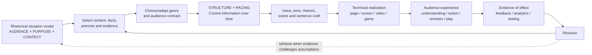

# Literacy Skills for Writing Across Audiences, Media, and Story Types

## Executive summary

The twelve writing types in scope—marketing, communications, scriptwriting, product marketing, content marketing, corporate writing, YouTube, RPG storytelling, fantasy, drama, comedy, and thriller—share a common literacy substrate, but they do **not** reward the same distribution of skills. The most important distinction is not “commercial versus creative writing”; it is the kind of **relationship the text establishes with an audience and the effect it is trying to produce**. Genre scholarship treats genres as socially recognized responses to recurring situations rather than merely collections of formal features, while audience theory has long treated audience as fundamental to composition. Canada’s own web-writing guidance similarly begins from audience needs, tasks, context, clarity, and usability. citeturn21view2turn21view3turn21view0

The **single most upstream element** is therefore an **accurate rhetorical-situation model: audience × purpose × context**. This is the writer's working representation of *who is receiving this, what they need or desire, what the writer wants to change or enable, what the audience already knows, and under what social/technical/genre constraints the encounter occurs*. This model determines what information belongs, what can be assumed, which conventions are useful, what evidence is credible, how much context is necessary, what tone is appropriate, and what ethical risks exist. The proposition is stronger than “know your audience”: purpose and context matter because the same audience can need radically different texts in a buying decision, emergency, comedy performance, RPG session, or fictional narrative. Miller's genre theory explicitly links genre to recurrent rhetorical situations and mediates between private intention and socially recognized need. citeturn21view3turn21view0

One of the most important **downstream elements** is **control of information and experience over time—structure plus pacing**. Once audience and purpose are understood, a writer must decide *what the audience receives, in what order, at what speed, and with what delays, repetitions, turns, proofs, choices, or payoffs*. Government information writing often puts essential information first; YouTube guidance stresses the opening seconds; screenwriting develops shifts scene by scene; RPG writing organizes choices and gameplay encounters; suspense research models tension partly through changes in uncertainty; and narrative-transportation research shows that sustained absorption affects story-consistent beliefs and evaluations. citeturn21view0turn21view4turn21view9turn21view5turn21view6turn22academia29turn14view0

The principal cross-domain literacies are consequently:

**rhetorical modelling → content/research selection → genre knowledge → structural and pacing control → voice and line-level execution → technical/media realization → ethical/legal checking → feedback-driven revision.**

Writing expertise is therefore better understood as **adaptive literacy** than as possession of one universally “good” style. The Government of Canada explicitly recommends writing for intended audience needs rather than institutional language, using familiar words, meaningful organization, primary audience evidence, and task-focused content; SSHRC likewise evaluates public research storytelling on clarity, persuasiveness, and engagement rather than on a single prose style. citeturn21view0turn21view13

The commercial forms differ meaningfully. **Marketing** primarily constructs and communicates value toward behaviour; the American Marketing Association formally describes marketing around creating, communicating, delivering, and exchanging offerings of value. **Product marketing** is more specifically concerned with product–market understanding, positioning, differentiation, messaging, launch/readiness, and growth. **Content marketing** trades immediate promotional pressure for useful, relevant material that builds a relationship with a clearly defined audience. **Communications** centres stakeholder understanding, trust, alignment, and response, while **corporate writing** commonly optimizes for institutional decisions, coordination, accountability, and durable records. citeturn16search27turn15search34turn21view8turn20search13turn21view0

The narrative forms differ chiefly in the reader/player/viewer contract. **Scriptwriting** must produce a story that can be converted into audiovisual performance. **YouTube writing** adds an exceptionally explicit attention and promise-delivery problem. **RPG storytelling** is unusual because the audience is also a causal participant: official D&D material describes tabletop roleplaying through collaborative storytelling, open-ended worldbuilding, chance, shared narrative, and consequential choice. **Fantasy** manages speculative possibility and world-model coherence; **drama** manages motivated conflict and change; **comedy** manages expectation, incongruity/violation, timing, and social permission; **thriller** manages threat, uncertainty, information asymmetry, and escalating consequence. citeturn21view9turn21view4turn21view5turn17search8turn22academia29

The highest-return development strategy for a professional writer or educator is consequently **not to study twelve unrelated sets of tricks**. Build the common cognitive/rhetorical system first; then deliberately train genre-specific conventions and media techniques. Proficiency should be assessed by observable effects—reader comprehension, decision quality, credible differentiation, retention, narrative tension, player agency, tonal recognition, factual traceability, and the writer's ability to transfer the same underlying material between audiences—not merely grammatical correctness or subjective “good writing.” This recommendation is an analytical synthesis of the research and professional guidance reviewed here. citeturn21view0turn21view1turn21view3turn21view13

## Analytical framework and cross-domain model

**Report schema**

```text
analysis_unit:
  type_id
  dominant_purpose
  audience_expectations
  literacy_skills:
    cognitive
    rhetorical
    technical
    genre_conventions
    audience_analysis
    voice_tone
    structure
    pacing
    research
    legal_ethical
  common_constraints
  micro_tasks[3]

cross_domain_model:
  upstream_element
  downstream_element
  feedback_loop

importance_scale:
  1 = supporting
  2 = useful
  3 = important
  4 = highly important
  5 = mission-critical
```

The ten skill dimensions overlap but are deliberately non-identical. **Cognitive literacy** covers problem representation, causal reasoning, perspective-taking, inference, information management, and revision. **Rhetorical literacy** concerns intended effect, framing, argument, credibility, emotion, and calls to thought/action. **Technical literacy** concerns the conventions and tooling of a delivery medium. **Genre literacy** is knowledge of socially recognized forms and audience contracts. **Audience analysis** models prior knowledge, needs, motivations, objections, risk, context, and cultural expectations. **Voice/tone** controls persona and register. **Structure** determines hierarchy and causal/order relations; **pacing** determines how quickly information, tension, proof, humour, or choice arrives. **Research literacy** concerns discovery, evaluation, synthesis, verification, and attribution. **Legal/ethical literacy** concerns truthful claims, consent/privacy, rights, accessibility, representation, foreseeable harm, and applicable rules. These dimensions synthesize cognitive writing research, rhetorical genre theory, audience theory, and professional practice rather than claiming to be an established psychometric taxonomy. citeturn21view1turn21view2turn21view3turn21view0

A particularly important implication of genre-as-social-action theory is that **conventions are functional rather than ornamental**. A briefing note puts decisions and implications where an executive can act on them; an advertisement compresses proposition and response; a screenplay externalizes story into observable action and dialogue; a thriller controls knowledge to produce uncertainty; an RPG scenario leaves causal space for players. Form follows the recurring social or experiential problem the genre solves. citeturn21view3turn21view0turn21view5

The creative/commercial divide also becomes less rigid under this model. Narrative can persuade: Green and Brock's experiments linked stronger narrative transportation—absorption involving attention, imagery, and affect—with stronger story-consistent beliefs and evaluations. Conversely, communications and marketing rely on story only when story advances the audience's task; the Government of Canada's guidance strongly privileges findability, comprehension, usefulness, and audience needs over ornament. The appropriate question is therefore not “Should this be storytelling?” but **“What experience best produces the legitimate intended effect for this audience?”** citeturn14view0turn21view0

The upstream-to-downstream relationship can be represented as follows:



The model is intentionally recursive. Hayes's work treats writing as a process sufficiently structured to support successive cognitive models rather than as simple transcription, while professional guidance repeatedly embeds testing, review, audience evidence, and iteration. The Pacific Screenwriting Program, for example, recommends interrogating an outline for whether the story makes sense, where shifts happen, and where the writer stumbles; Canada.ca recommends drawing on interviews, support interactions, search behaviour, analytics, and other evidence about actual audience needs. citeturn21view1turn21view9turn21view0

## AI-readable type-by-type skill map

**type_id: `marketing`**

**dominant_purpose:** Create, communicate, and make salient an exchangeable value proposition, then move an audience toward an appropriate behaviour: awareness, consideration, trial, purchase, renewal, referral, or another defined response. This aligns with the AMA's broader conception of marketing as activities and processes concerned with offerings of value. citeturn16search27

**audience_expectations:** Rapid relevance; recognition of a need/desire; a comprehensible value proposition; credible reasons to believe; low friction between promise and action; consistency between message and actual offer.

**literacy_skills:** `cognitive:` segmentation, salience judgement, objection modelling, compression, hypothesis formation; `rhetorical:` positioning, framing, benefit articulation, proof, persuasion, CTA design; `technical:` channel formats, landing pages, email/social/ad constraints, analytics vocabulary; `genre_conventions:` hook→value→proof→action and campaign-message systems; `audience_analysis:` motivations, awareness level, decision stage, objections, context; `voice_tone:` brand-consistent but audience-adaptive; `structure:` message hierarchy and progressive proof; `pacing:` fast relevance with delayed detail; `research:` customer language, competitive context, market evidence, performance data; `legal_ethical:` claim substantiation, honest overall impression, consent/privacy and channel compliance. Canadian advertising law prohibits materially false or misleading representations, while CASL imposes specific requirements on many commercial electronic messages. citeturn21view10turn21view11

**common_constraints:** scarce attention; channel character/runtime limits; differentiation pressure; conversion objectives; brand consistency; approval cycles; uncertain attribution; risk that persuasion outruns product truth.

**micro_tasks:** `A:` Rewrite a generic “best-in-class” claim as a specific value proposition supported by one verifiable proof point. `B:` Write three versions of the same campaign message for unaware, problem-aware, and solution-aware audiences. `C:` Build a 75-word commercial email containing one proposition, one proof element, and one unambiguous next step.

**type_id: `communications`**

**dominant_purpose:** Enable stakeholders to understand, interpret, trust, and appropriately respond to information from or about an organization.

**audience_expectations:** Accuracy, timeliness, clarity, context, credibility, relevance to the stakeholder's interests, and consistency between words and organizational behaviour. Canadian professional PR practice explicitly situates ethics and professional standards as core concerns. citeturn20search13

**literacy_skills:** `cognitive:` stakeholder mapping, issue framing, consequence forecasting, ambiguity resolution; `rhetorical:` key-message architecture, explanation, reputation/trust management, question anticipation; `technical:` releases, statements, FAQs, briefing materials, web/social formats; `genre_conventions:` key messages, holding statements, backgrounders, Q&A, public notices; `audience_analysis:` stakeholder knowledge, concern, authority, exposure and information needs; `voice_tone:` credible, proportionate, empathetic where warranted, non-defensive; `structure:` answer/key fact first, then context and action; `pacing:` urgency calibrated to issue severity and channel; `research:` factual verification, stakeholder evidence, subject-matter-expert validation; `legal_ethical:` transparency, confidentiality/privacy, accessibility, misleading omission risk and institutional obligations.

Canada.ca explicitly recommends audience-centred, task-focused, plain-language information whose intended audience can find, understand and use it, making it a strong Canadian reference model even outside government. citeturn21view0

**common_constraints:** multiple audiences with conflicting interests; rapid deadlines; reputational consequences; approvals; incomplete emerging information; accessibility/bilingual or other institutional requirements; media reinterpretation.

**micro_tasks:** `A:` Turn a 600-word internal explanation into a 150-word public notice with action required in the opening paragraph. `B:` Build a three-message issue map, each with evidence and one anticipated hostile question. `C:` Draft a holding statement that distinguishes confirmed facts, unknowns, action underway, and next update.

**type_id: `scriptwriting`**

**dominant_purpose:** Create a producible audiovisual experience through scenes, observable action, dialogue, character behaviour, sound, and transitions rather than explanatory prose alone.

**audience_expectations:** A readable script and a compelling eventual screen experience; purposeful scenes; character intention and conflict; visual/auditory storytelling; causal progression; dialogue with more function than information delivery.

**literacy_skills:** `cognitive:` causal simulation, spatial/temporal reasoning, character modelling, compression; `rhetorical:` implication, dramatic irony, subtext, revelation and emotional framing; `technical:` scene headings, action lines, dialogue, screenplay pagination/software conventions; `genre_conventions:` scene/sequences, turning points, setups/payoffs, act or episode architectures where applicable; `audience_analysis:` dual audience—industry collaborators/readers and eventual viewers; `voice_tone:` distinctive character voices plus concise neutral action prose; `structure:` scenes built around changed conditions; `pacing:` beat, scene, sequence and whole-script rhythm; `research:` setting/profession/procedure plus production realities; `legal_ethical:` rights, factual claims, privacy/real-person issues, representation and production constraints.

A Canadian industry training source, the Pacific Screenwriting Program, explicitly recommends laying out scenes, pitching/retelling the outline, checking whether the story makes sense, and identifying what must shift in individual scenes. citeturn21view9turn16search28

**common_constraints:** runtime/page economy; production budget and locations; cast; episode/format requirements; visual feasibility; collaboration and revision; rights and commissioning requirements.

**micro_tasks:** `A:` Convert one page of interior prose into a one-page scene in which the same meaning is conveyed entirely by action, dialogue and silence. `B:` Write a two-character scene in which each character wants something incompatible but neither states the conflict directly. `C:` Annotate every scene in a five-page sequence with `entry state → objective → obstacle → turn → exit state`.

**type_id: `product_marketing`**

**dominant_purpose:** Translate product reality and market understanding into differentiated positioning, messaging, launch/readiness and adoption narratives.

**audience_expectations:** Precise relevance to their problem; understandable distinction from alternatives; believable product capabilities; evidence; fit with workflow/context; reduced purchase risk.

**literacy_skills:** `cognitive:` product/customer mental-model synthesis, segmentation, competitive reasoning, feature→benefit→outcome translation; `rhetorical:` positioning, category framing, value propositions, proof hierarchy, objection handling; `technical:` product terminology, demos, enablement, release/launch formats, comparison matrices; `genre_conventions:` positioning documents, message houses, battlecards, launch narratives, product pages; `audience_analysis:` user/buyer/champion/economic buyer differences and decision criteria; `voice_tone:` authoritative without overclaiming; `structure:` problem→alternative→differentiated capability→outcome→proof; `pacing:` progressively deeper detail as evaluation advances; `research:` voice-of-customer, interviews, win/loss data, competitive evidence, product documentation; `legal_ethical:` product-claim accuracy, comparative claims, pricing/data/privacy implications.

Product Marketing Alliance's current framework organizes the field into stages including discover, strategize, define, get set, and grow and treats areas such as customer research, competitive intelligence, positioning and messaging as central product-marketing concerns. citeturn15search34turn15search14

**common_constraints:** product changes faster than collateral; multiple decision-makers; pressure to differentiate without inventing differences; sales/product/marketing stakeholder alignment; technical complexity; proof availability.

**micro_tasks:** `A:` Convert five product features into benefits, then into customer outcomes, rejecting any outcome that cannot be defended. `B:` Write a positioning statement for one clearly defined segment and explain why it would *not* work for another. `C:` Build a competitive message that names a meaningful distinction without making an unsupported superiority claim.

**type_id: `content_marketing`**

**dominant_purpose:** Earn attention and trust over time by providing genuinely useful/relevant material to a defined audience while advancing a longer-term commercial strategy. This closely matches the Content Marketing Institute's definition centred on valuable, relevant, consistent content and a clearly defined audience. citeturn21view8

**audience_expectations:** A useful answer, insight, method, example, entertainment or tool before being asked for commercial commitment; evidence of expertise; low promotional intrusion; findability and scannability.

**literacy_skills:** `cognitive:` search/problem-intent inference, synthesis, pedagogical decomposition, editorial judgement; `rhetorical:` explanation, demonstration, credibility and low-pressure conversion; `technical:` CMS, SEO/search concepts, metadata, links, multimedia and analytics; `genre_conventions:` articles, guides, case studies, newsletters, explainers, reports; `audience_analysis:` search intent, stage of knowledge, professional vocabulary, recurring questions; `voice_tone:` useful, credible, consistent, often conversational; `structure:` answer-first headings plus progressively deeper material; `pacing:` rapid usefulness with optional depth; `research:` SME interviews, source validation, topic/keyword evidence, updating; `legal_ethical:` originality, sourcing, commercial transparency and claim accuracy.

Google Search Central explicitly frames search-trend evidence as useful for understanding how people seek information and refining both content strategy and how organizations talk to their audiences. citeturn15search27

**common_constraints:** sustained publishing cadence; discoverability; content decay; SME availability; balancing usefulness and conversion; duplication/commoditization; measuring influence across long journeys.

**micro_tasks:** `A:` Take one search/problem query and produce an outline whose first screen answers it before expanding. `B:` Turn a 20-minute SME interview into a 700-word evidence-led article while marking every claim that still needs verification. `C:` Audit an older evergreen article and classify every paragraph as keep, update, substantiate, restructure, or remove.

**type_id: `corporate_writing`**

**dominant_purpose:** Support decisions, coordination, governance, institutional memory, accountability, and execution.

**audience_expectations:** Fast comprehension of what matters; explicit decision/action; traceable rationale; factual reliability; low ambiguity; appropriate organizational register.

**literacy_skills:** `cognitive:` synthesis, prioritization, decision framing, risk reasoning; `rhetorical:` recommendation, justification, qualification and escalation; `technical:` memos, briefing notes, reports, policies, executive emails, slide text; `genre_conventions:` purpose/context/options/recommendation/risks/action; `audience_analysis:` authority, decision rights, domain knowledge, time available and consequences; `voice_tone:` concise, professional, proportionate, non-theatrical; `structure:` decision-critical information before supporting detail; `pacing:` information density rather than dramatic delay; `research:` organizational records, data, subject-matter validation and source traceability; `legal_ethical:` confidentiality, records, privacy, accessibility, accuracy and governance.

Canada's Content Style Guide is especially transferable here: it treats clarity as the ability of intended users to find, understand, and use information, advocates familiar language and meaningful organization, and centres actual audience needs rather than the organization's internal vocabulary. citeturn21view0

**common_constraints:** executive time scarcity; approval hierarchies; competing stakeholders; durable records; confidentiality; high cost of ambiguity; house styles/templates.

**micro_tasks:** `A:` Reduce a three-page issue description to a one-page briefing note whose recommendation and consequences can be understood in 60 seconds. `B:` Rewrite a policy clause so an affected employee can identify both their obligation and next action without specialist interpretation. `C:` Draft an executive email with exactly four functions: decision, rationale, risk, next owner/date.

**type_id: `youtube`**

**dominant_purpose:** Deliver a promised audiovisual experience while continually earning the viewer's decision to keep watching.

**audience_expectations:** Rapid confirmation that the title/topic promise will be fulfilled; immediate context or curiosity; spoken-language clarity; audiovisual variation; forward momentum; proportionate payoff.

**literacy_skills:** `cognitive:` attention modelling, audiovisual planning, compression and expectation management; `rhetorical:` hooks, questions, promises, demonstrations, reveals and calls to action; `technical:` A-roll/B-roll, voiceover, graphics, shot/audio notes, chaptering, title/thumbnail coordination; `genre_conventions:` cold opens, previews, demonstrations, commentary, episodic callbacks depending on channel; `audience_analysis:` viewer intent, familiarity, likely abandonment points, community language; `voice_tone:` speech-native, personable, distinctive and performance-compatible; `structure:` promise→progressive delivery→payoff; `pacing:` exceptionally important—frequent meaningful changes in information, visuals, stakes or question state; `research:` factual verification plus audience/search/analytics evidence; `legal_ethical:` copyright/rights, privacy, sponsorship/marketing disclosure, claims and platform rules.

Official YouTube creator guidance says the opening seconds are critical and recommends strategies such as starting with a question, stating what viewers will see, or using a cold opening; it specifically illustrates communicating the video's value within roughly the opening five seconds. citeturn21view4

**common_constraints:** viewer abandonment is effortless; runtime and production resources; spoken-word density; editing feasibility; title/thumbnail expectations; platform distribution; visual rights.

**micro_tasks:** `A:` Write three 30-second openings for one video: question-led, result-first, and cold-open narrative; each must identify the value of continuing. `B:` Make a five-minute beat sheet where every beat specifies both `new information` and `visual/audio realization`. `C:` Take a segment with poor audience retention and propose three competing causal hypotheses before rewriting it.

**type_id: `rpg_storytelling`**

**dominant_purpose:** Create situations, characters, worlds and consequences from which participants can **co-produce** an unfolding story through meaningful decisions and game mechanics.

**audience_expectations:** Agency; legible choices; responsive consequences; coherent setting; fair interaction with rules; room for improvisation; distributed spotlight; uncertainty not predetermined solely by the author/GM.

**literacy_skills:** `cognitive:` branching causal reasoning, state tracking, improvisation, probability/rule reasoning, listening; `rhetorical:` evocative prompts, clue communication, NPC persuasion, framing choices without dictating them; `technical:` system rules, encounter/scenario documents, stat blocks, maps, clues and modular notes; `genre_conventions:` hooks, locations, factions, encounters, discoveries, choices/consequences; `audience_analysis:` player preferences, character goals, group tone and system mastery; `voice_tone:` adaptable narration plus differentiated NPC voices; `structure:` situation/network rather than immutable plot; `pacing:` spotlight rotation, escalation, decision time, encounters and breathers; `research:` system rules, setting, historical/cultural inspirations; `legal_ethical:` consent/boundaries, table safety, representation, IP/licensing where published.

Official D&D describes the form in terms of collaborative storytelling, open-ended worldbuilding, imagination, chance and shared narrative, and describes choice as shaping the tale. D&D Beyond also describes combat, social interaction, and exploration as foundational gameplay building blocks for campaign writing. citeturn21view5turn21view6

**common_constraints:** authored preparation cannot predict player choices; mechanics can overturn intended outcomes; several participants require meaningful participation; live improvisation; limited session time; campaign continuity.

**micro_tasks:** `A:` Take a linear scene (“heroes must persuade the duke”) and rewrite it as a situation with at least three genuinely different approaches and consequences. `B:` Create an NPC card containing only `want`, `fear`, `leverage`, `voice cue`, `secret`, and `reaction if thwarted`. `C:` Design a clue that can fail at the immediate task without making the entire scenario impossible to continue.

**type_id: `fantasy`**

**dominant_purpose:** Produce an emotionally and causally credible experience involving realities, powers, beings or world conditions beyond ordinary actuality.

**audience_expectations:** A contract appropriate to the subgenre; imaginative discovery; enough world coherence to reason about consequence; characters whose choices matter within the invented conditions; controlled rather than indiscriminate exposition.

**literacy_skills:** `cognitive:` world-model construction, counterfactual reasoning, causal consistency, continuity management; `rhetorical:` defamiliarization, wonder, symbolic resonance, selective exposition; `technical:` continuity bibles, maps/timelines/glossaries where useful; `genre_conventions:` speculative premise, invented-world or intrusion logic, quests/myths/magic only where appropriate to the particular subgenre; `audience_analysis:` epic, urban, dark, romantic, mythic, literary and other fantasy audiences bring different conventions; `voice_tone:` register coherent with narrative distance and world; `structure:` reveal world through consequence and character need; `pacing:` regulate discovery, action, reflection and explanation; `research:` history, ecology, material culture, language, religion/folklore as relevant; `legal_ethical:` cultural sourcing, stereotyping/representation and rights issues.

The key general principle comes from genre research rather than a universal fantasy formula: genres are culturally recognized, evolving classes of social action, not neat or mutually exclusive taxonomies. Thus “fantasy literacy” means knowing which conventions a particular work activates and which expectations it intentionally changes. Narrative transportation research further supports treating immersive story experience as a consequential cognitive state rather than treating worldbuilding as an inventory of facts. citeturn21view3turn14view0

**common_constraints:** exposition burden; continuity across invented systems; names/terms competing for working memory; balancing novelty with comprehensibility; avoiding worldbuilding that has no dramatic function.

**micro_tasks:** `A:` Explain one rule of magic through a character paying its cost rather than through narrator exposition. `B:` Introduce a world fact through disagreement between two characters who have different stakes in it. `C:` Audit one invented culture and identify where it is merely a renamed analogue, internally diverse, historically caused, or built from an unexamined stereotype.

**type_id: `drama`**

**dominant_purpose:** Produce emotionally credible change through conflicting wants, relationships, choices and consequences.

**audience_expectations:** Motivated behaviour; meaningful stakes; conflict larger than simple argument; emotional causality; subtext; transformations or revelations earned by prior action.

**literacy_skills:** `cognitive:` theory-of-mind, motive modelling, causal and emotional continuity; `rhetorical:` subtext, implication, status, dramatic irony, emotional reframing; `technical:` medium-specific scene/prose/play conventions; `genre_conventions:` objectives, obstacles, reversals, revelations, relational consequences; `audience_analysis:` tolerance for ambiguity, intensity, realism and melodrama varies by form/audience; `voice_tone:` character-specific and emotionally precise; `structure:` actions create altered relationships and subsequent choices; `pacing:` escalation, silence, reversals and recovery; `research:` human contexts, professions, social settings and lived realities; `legal_ethical:` representation, trauma, privacy/rights if drawing closely from real people.

Narrative-transportation research is relevant because absorption combines attention, imagery and affect and can alter evaluations; script-development practice likewise emphasizes knowing where shifts occur in scenes. These findings support treating emotional sequence and changed conditions as core craft variables rather than relying on “dramatic” subject matter alone. citeturn14view0turn21view9

**common_constraints:** melodrama without credible motivation; exposition disguised as dialogue; conflict that repeats without changing conditions; emotional turns unsupported by prior behaviour.

**micro_tasks:** `A:` Write a scene where two people discuss an ordinary object while actually negotiating whether their relationship will continue. `B:` Rewrite five explicit emotional statements so each becomes observable behaviour or implication. `C:` Identify the exact choice that changes a dramatic scene and write two plausible versions in which the character chooses differently.

**type_id: `comedy`**

**dominant_purpose:** Generate amusement through managed expectation, recognition, incongruity, violation, timing, character, linguistic pattern or social perspective while preserving the audience's permission to laugh.

**audience_expectations:** Surprise that remains retrospectively intelligible; economy; timing; a recognizable comic premise/voice; escalation or variation rather than mere repetition.

**literacy_skills:** `cognitive:` prediction modelling, associative flexibility, pattern formation/breaking, compression; `rhetorical:` setup, misdirection, reveal, callback, exaggeration, understatement and specificity; `technical:` punctuation/read-aloud/performance timing and medium-specific beat lengths; `genre_conventions:` setup/punch, rule of three, tags, callbacks, comic character/world logic; `audience_analysis:` especially high importance because social norms determine what reads as surprising, acceptable, cruel, familiar or taboo; `voice_tone:` unusually central—the same premise can succeed or fail by persona; `structure:` expectation→revision/payoff, often in nested patterns; `pacing:` timing is semantic, not decorative; `research:` cultural references, audience norms, subject accuracy where satire depends on fact; `legal_ethical:` foreseeable harm, stereotyping, factual accusations, consent/privacy and context.

One useful but non-exclusive research model is McGraw and Warren's **benign violation** account: humour can arise when something is simultaneously perceived as a violation and as sufficiently benign. The researchers themselves and subsequent work treat psychological/social distance as relevant, reinforcing why audience modelling is unusually consequential in comedy. This is a model of some humour, not a complete theory of comedy. citeturn17search8turn17news29

**common_constraints:** jokes age rapidly; explanation kills compression; audience norms vary; targets can change perceived ethical meaning; surprise declines with repetition; performance alters written timing.

**micro_tasks:** `A:` Give one setup three punchlines for three audiences—children, professional peers, and a late-night adult audience—and identify what background assumption changes. `B:` Write a rule-of-three sequence in which the third item changes the reader's interpretation of the first two. `C:` Remove every phrase after a punchline that explains why the joke is funny, then read both versions aloud.

**type_id: `thriller`**

**dominant_purpose:** Sustain forward pressure through consequential uncertainty: threat, pursuit, secrets, deadlines, narrowing options, reversals and delayed resolution.

**audience_expectations:** credible stakes; consequential danger; unanswered questions that matter; escalating or transforming pressure; fair-enough foreshadowing that later revelations feel earned rather than arbitrary.

**literacy_skills:** `cognitive:` information-state tracking, causal plotting, scenario forecasting, clue/payoff management; `rhetorical:` concealment/revelation, dramatic irony, foreshadowing and perspective control; `technical:` timelines, clue ledgers and procedural continuity; `genre_conventions:` threats, objectives, deadlines, reversals, pursuit, conspiracy/mystery elements where appropriate; `audience_analysis:` calibrate complexity, violence, realism and genre familiarity; `voice_tone:` precision and controlled uncertainty; `structure:` tightening causal constraints with strategically altered knowledge; `pacing:` exceptionally high importance—alternating acceleration, anticipation and release; `research:` procedures, places, technology, organizations and factual plausibility; `legal_ethical:` responsible factual representation, real-person/group risk, trauma/violence judgement and rights.

Computational narrative work comparing model predictions with human suspense judgements found forward-looking uncertainty reduction useful for predicting suspenseful events, while broader narrative research links absorption to attention and affect. These do not prescribe a thriller formula, but they support the craft intuition that suspense depends on **what futures the audience can imagine and how those possibilities change**, not merely on frequent action. citeturn22academia29turn14view0

**common_constraints:** plot causality is fragile; withheld information can feel manipulative; escalation can become monotonous; procedural inaccuracies break credibility; twists can invalidate prior character logic.

**micro_tasks:** `A:` Create a five-step tension ladder where each step removes an option rather than merely increasing physical danger. `B:` Write one 300-word scene twice: first with protagonist and reader equally ignorant, then with the reader knowing the threat the protagonist cannot see. `C:` Build a ledger with `setup → reader interpretation → hidden truth → reveal → consequence` for every major twist.

## Comparative synthesis and visual skill matrix

The table below summarizes the strongest differences. “Primary contract” means the implicit bargain the audience expects the writer to honour. The categories deliberately overlap: for example, a YouTube product launch may simultaneously require YouTube, product-marketing, content-marketing, comedy and scriptwriting literacies. Genre is an evolving repertoire, not an exclusive container. citeturn21view3

| Writing type | Dominant outcome | Primary audience contract | Distinctive structural problem | Characteristic constraint |
|---|---|---|---|---|
| Marketing | Behaviour/value exchange | “Show why this matters to me.” | Compress value, proof and action | Attention + claim accuracy |
| Communications | Understanding/trust/response | “Tell me what is true, relevant and happening.” | Prioritize key information amid uncertainty | Stakeholders + reputation |
| Scriptwriting | Audiovisual dramatic experience | “Make me see/hear the story.” | Cause change through scenes | Runtime + producibility |
| Product marketing | Product-market understanding/adoption | “Show why this solution fits and differs.” | Connect problem, capability, distinction and proof | Product truth + many buyers |
| Content marketing | Useful relationship over time | “Help me before asking me to buy.” | Answer quickly, then deepen | Discoverability + sustained value |
| Corporate writing | Decision/coordination | “Help me decide or act correctly.” | Hierarchize decision-critical information | Time + governance |
| YouTube | Continued voluntary attention | “Deliver the promise that made me click.” | Re-earn attention while progressing | Instant abandonment |
| RPG storytelling | Collaborative play/story | “My decisions can meaningfully change events.” | Prepare causality without predetermining outcomes | Player agency + rules |
| Fantasy | Speculative immersion | “Make the impossible meaningfully coherent.” | Reveal world without exposition overload | World-model complexity |
| Drama | Emotional/relational change | “Make these choices and feelings credible.” | Turn motives into consequential action | Emotional causality |
| Comedy | Amusement | “Surprise me in a way I can accept/read as funny.” | Set and break expectation efficiently | Timing + audience norms |
| Thriller | Sustained consequential uncertainty | “Keep outcomes uncertain but causally credible.” | Control possibility, knowledge and threat | Causality + escalation |

The distinction among adjacent professional forms is particularly important. Marketing writing optimizes a value/action relationship; product marketing develops the **market interpretation of a particular product**; content marketing creates **useful audience value before or alongside the sales proposition**; communications manages **stakeholder meaning and trust**; and corporate writing manages **organizational decision and action**. Treating all five as “copywriting” discards crucial differences in research method, evidence, structure and accountability. citeturn16search27turn15search34turn21view8turn20search13turn21view0

Likewise, narrative categories differ in who controls causality. A novelist generally controls all consequential events; a scriptwriter controls a blueprint that other collaborators realize; a YouTube writer works within an edited audiovisual product where viewers can leave continuously; an RPG writer must deliberately surrender part of causal authorship to players and game systems. Official D&D's emphasis on shared narrative and choices makes the latter distinction especially important. citeturn21view4turn21view5

### Relative skill-importance matrix

The following **1–5 values are an analytical synthesis, not experimentally normed measurements**. They indicate how costly weakness in a dimension normally is to the type's defining audience contract. The rankings derive from the preceding cognitive/rhetorical framework and professional/genre evidence. citeturn21view0turn21view1turn21view3turn21view4turn21view5turn14view0

| Type | Cog | Rhet | Tech | Genre | Aud | Voice | Struct | Pace | Research | Legal / ethical |
|---|---:|---:|---:|---:|---:|---:|---:|---:|---:|---:|
| Marketing | 4 | **5** | 4 | 4 | **5** | **5** | 4 | **5** | 4 | **5** |
| Communications | 4 | **5** | 4 | 4 | **5** | **5** | **5** | 4 | **5** | **5** |
| Scriptwriting | **5** | **5** | **5** | **5** | 4 | **5** | **5** | **5** | 4 | 4 |
| Product marketing | **5** | **5** | 4 | 4 | **5** | **5** | **5** | 4 | **5** | **5** |
| Content marketing | 4 | **5** | **5** | 4 | **5** | **5** | **5** | 4 | **5** | **5** |
| Corporate writing | **5** | **5** | 4 | **5** | **5** | 4 | **5** | 3 | **5** | **5** |
| YouTube | 4 | **5** | **5** | **5** | **5** | **5** | **5** | **5** | 4 | **5** |
| RPG storytelling | **5** | **5** | **5** | **5** | **5** | **5** | **5** | **5** | 4 | **5** |
| Fantasy | **5** | **5** | 4 | **5** | 4 | **5** | **5** | **5** | **5** | 4 |
| Drama | **5** | **5** | 4 | **5** | 4 | **5** | **5** | **5** | 4 | 4 |
| Comedy | **5** | **5** | 4 | **5** | **5** | **5** | **5** | **5** | 4 | **5** |
| Thriller | **5** | **5** | 4 | **5** | 4 | **5** | **5** | **5** | **5** | 4 |

`Cog = cognitive; Rhet = rhetorical; Tech = technical/platform; Aud = audience analysis; Struct = structure.`

Several overlaps are revealing. **Rhetorical and structural literacy are near-universal**, because every form has to transform intention into an ordered audience experience. **Audience analysis peaks in persuasive, public, interactive, comic and platform-mediated forms**, where misreading the audience immediately changes outcomes. **Technical literacy rises when the text is only one component in a larger production system**—screen, YouTube, RPG—or when discoverability and publishing infrastructure matter. **Research is highest where claims, products, procedures, worlds or institutional decisions must withstand scrutiny. Legal/ethical literacy becomes particularly acute when writing directly affects real consumers, stakeholders, employees, identifiable people, or co-participants.** These are analytical conclusions from the source framework rather than universal numerical laws. citeturn21view0turn21view10turn21view11turn21view4turn21view5

### The upstream element: rhetorical-situation modelling

The best candidate for a single upstream literacy is:

> **Construct and continuously update an accurate model of the rhetorical situation: audience × purpose × context.**

It precedes language choice. Before choosing whether a sentence should be funny, concise, lyrical, suspenseful, authoritative or sales-oriented, the writer must know what relationship the text is supposed to establish and what audience state it is supposed to change.

Three bodies of evidence converge here. First, Ede and Lunsford's foundational composition scholarship explicitly makes audience a central theoretical problem in writing. Second, Miller conceptualizes genres as typified rhetorical responses to recurrent situations, mediating private purposes and socially recognized needs; genre therefore follows situation rather than merely imposing decorative conventions. Third, contemporary Canadian content guidance operationalizes the same principle: determine audience needs, use evidence from actual users, organize content around their tasks, and choose language they can find, understand and use. citeturn21view2turn21view3turn21view0

This model also explains transfer. Suppose the underlying fact is:

> “A software update reduces report-generation time from ten minutes to two.”

A corporate briefing asks: **What decision follows?** Product marketing asks: **For which customer is that reduction differentiated and valuable?** Marketing asks: **What proposition will make that value salient enough to act?** Content marketing asks: **What problem can we help someone solve using this knowledge?** A YouTube script asks: **What demonstration makes the eight-minute difference visible quickly?** Comedy asks: **What expectation around waiting can be overturned?** Drama asks: **Why does eight minutes matter emotionally to this character?** A thriller asks: **What happens when those eight minutes are the difference between success and catastrophe?** RPG writing asks: **What choice becomes newly possible because the report arrives sooner?**

The fact remains constant. **The rhetorical situation determines what the fact becomes.**

### The downstream element: structure and pacing

The strongest candidate for a common downstream realization skill is:

> **Control what the audience knows, feels, expects or can do by controlling the sequence and timing of information.**

This is structure and pacing understood broadly—not merely “three acts” or sentence rhythm.

In public/informational writing, Canada.ca recommends putting important information where users can find it and structuring information around their tasks. In YouTube, official guidance treats the opening seconds as a decisive interval for establishing context or curiosity. In screenwriting, scene design asks where story shifts occur. In RPGs, encounters, social interaction and exploration become compositional building blocks whose order and consequences respond to play. In thrillers, computational narrative research finds that changing anticipated possibilities is predictive of perceived suspense. citeturn21view0turn21view4turn21view9turn21view6turn22academia29

Narrative transportation research supplies a further bridge: absorption into a story involves focused attention, imagery and affect and was associated experimentally with story-consistent beliefs and evaluations. Structure and pacing are not the only causes of transportation, but they are among the mechanisms writers can directly manipulate to sustain or break an audience's mental engagement. citeturn14view0

This produces a useful universal question for revision:

> **At every moment, what does the audience currently know, want, fear, expect, doubt, or need—and what should the next unit of writing change?**

In a memo, that “unit” may be a paragraph. In advertising, a phrase or frame. In a screenplay, a beat. In YouTube, a shot/beat. In comedy, a setup or punch. In a thriller, a clue/reversal. In RPGs, a player choice and consequence.

## Prioritized skill-development programme and proficiency indicators

The proficiency indicators below are **recommended assessment criteria**, not published population norms. Percentages are proposed thresholds that a professional writer/educator can calibrate to task difficulty, audience risk, and baseline performance.

| Priority | Capability to develop | Deliberate practice | Measurable proficiency evidence |
|---|---|---|---|
| **Highest** | Rhetorical-situation modelling | Rewrite one source fact for 4–6 audiences/purposes without changing the underlying truth | Before drafting, writer can state audience, desired change, prior knowledge, context and major constraint; ≥80% of target readers correctly identify intended main point/action in testing |
| **Highest** | Information hierarchy, structure and pacing | Outline before prose; annotate each unit with its function/change | Independent reader can locate the main proposition/action quickly; scenes/beats demonstrably change knowledge, stakes, relationship or options; no major section exists without a defined function |
| **Highest** | Research and epistemic discipline | Maintain claim→source→confidence logs; favour primary evidence; separate fact/inference/proposal | 100% of materially verifiable claims are traceable during audit; unsupported claims are removed or clearly qualified; corrections are reproducible |
| **Very high** | Genre literacy | Read/annotate a representative corpus; reconstruct forms; imitate then intentionally violate conventions | Writer can identify the function—not merely the name—of major conventions and explain why an intentional deviation improves the audience effect |
| **Very high** | Audience-language fluency | Collect authentic questions, interviews, support language, comments, search terms or play observations | Draft uses the audience's conceptual vocabulary without merely parroting jargon; comprehension testing reveals few unexplained expert assumptions |
| **Very high** | Voice/register range | Rewrite identical content in multiple controlled registers | Blind reviewers reliably distinguish intended voices/audiences; writer can change tone without changing facts or accidentally changing commitments |
| **High** | Feedback-driven revision | Diagnose before editing: hypothesize the cause of failure, alter the appropriate level, re-test | Revision changes structure/argument/scene logic when needed rather than defaulting to copy-editing; post-revision measure improves on the pre-revision measure |
| **High** | Ethical/legal risk recognition | Add a pre-publication review layer for claims, privacy, rights, accessibility, representation and consent | High-risk assertions have proof/approval; required permissions are documented; no known critical accessibility or misleading-claim issue survives review |

The **first practice should be transformation, not specialization**. Take one source packet and produce a corporate brief, product-marketing page, campaign ad, explanatory article, YouTube opening, dramatic scene, comic version, thriller version and RPG encounter. This makes the hidden variables visible: what changed because of audience, what changed because of purpose, what changed because of medium, and what facts were required to remain invariant. This approach follows directly from the distinction between rhetorical situation and genre response. citeturn21view3turn21view0

The **second practice should be structural annotation**. For information writing, label each unit `question answered / evidence / implication / action`. For persuasion, use `problem / proposition / proof / objection / action`. For scripts and drama, use `objective / obstacle / turn / consequence`. For thriller, use `known / suspected / hidden / newly revealed / option lost`. For comedy, use `expectation / violation / reinterpretation`. For RPGs, use `situation / choices / information / mechanics / consequences`. These are teaching tools rather than mandatory formulas; their purpose is to force the writer to account for changes in audience state. The underlying emphasis on structure is consistent with Canada.ca, YouTube, screenwriting and RPG guidance. citeturn21view0turn21view4turn21view9turn21view6

The **third practice should be evidence-preserving adaptation**. A professional writer should be able to simplify without falsifying. Canada.ca's plain-language model is useful here because it defines successful plain language functionally—people should be able to find, understand and use information—rather than as indiscriminate removal of complexity. Product and corporate writers in particular need to distinguish *necessary technical precision* from *unnecessary institutional language*. citeturn21view0

The **fourth practice should be corpus-based genre learning**. Rather than memorizing prescriptive rules such as “every screenplay must…” or “all marketing copy should…”, gather strong contemporary examples from the actual venue, audience and subgenre. Miller's genre theory is especially useful pedagogically here: genres are culturally dependent and evolving, recognized in practice, and do not form a clean mutually exclusive taxonomy. citeturn21view3

The **fifth practice should be controlled experimentation with pacing**. Give learners identical content and require one version optimized for immediate comprehension, another for curiosity, another for suspense, another for comedy, and another for player choice. The exercise reveals that pacing is fundamentally the management of **when understanding arrives**. YouTube's first-seconds guidance and research on suspense and narrative transportation give this practice an evidence base beyond purely prescriptive craft advice. citeturn21view4turn22academia29turn14view0

The **sixth practice should be effect-based revision**. Before revising, write a diagnostic statement: `Observed failure → hypothesized cause → proposed change → measure`. Examples include `readers miss action → recommendation buried → move decision forward → five-user retrieval test`; `viewers leave at 0:40 → context repeats title rather than progressing → compress/reveal example → compare retention`; `players ignore clue → clue does not imply actionable possibility → add consequence-bearing context → observe next session`. The Pacific Screenwriting Program's advice to test whether the story makes sense and identify where its telling stumbles is a domain-specific example of the broader principle. citeturn21view9turn21view0

A strong capstone assessment is a **transfer portfolio**, not twelve unrelated assignments. Give the writer one evidence base and ask them to create four informational/persuasive pieces and four narrative/interactive pieces, each accompanied by a one-page rationale naming audience, purpose, context, conventions adopted/rejected, information sequence, evidence standard and ethical risks. Score the work on both **artifact quality** and **quality of adaptation**. This assesses the upstream literacy that actually permits movement across forms.

## Source guide and representative references

For a professional writer or educator in Canada, the following source stack offers unusually good coverage because it combines Canadian public standards, professional/industry practice, composition/rhetorical theory, cognitive writing research, narrative psychology and medium-specific craft.

| Source | Type | Best use in curriculum/research |
|---|---|---|
| **Government of Canada — Canada.ca Content Style Guide** | Canadian official | Audience needs, plain language, task orientation, information hierarchy, web readability, accessibility-oriented content practice and audience evidence. It is the strongest general-purpose Canadian source in this review. citeturn21view0 |
| **Competition Bureau Canada — Deceptive Marketing Practices** | Canadian official/legal | Marketing/product/content claim accuracy, misleading overall impression, substantiation and ethical persuasion. citeturn21view10 |
| **CRTC — Canada's Anti-Spam Legislation guidance** | Canadian official/legal | Email/commercial-message literacy: consent, sender identification and unsubscribe obligations. citeturn21view11 |
| **Office of the Privacy Commissioner of Canada — Privacy Guide for Businesses/PIPEDA material** | Canadian official/legal | Privacy literacy when audience research, customer information or personalization involves personal information. citeturn0search28 |
| **SSHRC — The Storytellers** | Canadian official | Excellent compact model for public-facing research communication: submissions are judged on clarity, persuasiveness, creativity/engagement, with severe time/word constraints. citeturn21view13 |
| **Canadian Public Relations Society — professional standards/ethics materials** | Canadian professional | Communications ethics, professional responsibility and stakeholder practice. citeturn20search13turn20search5 |
| **Pacific Screenwriting Program, British Columbia** | Canadian industry/education | Practical screenplay development, outlining, scene shifts, pitching and revision. citeturn21view9turn16search28 |
| **American Marketing Association — Definition of Marketing** | Professional/academic association | A disciplined boundary around marketing as value creation, communication, delivery and exchange rather than “writing ads.” citeturn16search27 |
| **Content Marketing Institute — What Is Content Marketing?** | Industry | Distinguishes useful, relevant audience content from direct promotional pitching. citeturn21view8 |
| **Product Marketing Alliance — product-marketing framework** | Industry | Current field map for discovery, strategy, positioning/messaging, readiness and growth; useful for separating PMM from general marketing. citeturn15search34turn15search14 |
| **Google Search Central** | Primary platform guidance | Search/audience discovery and evidence-led content strategy; Google explicitly suggests using search trends to understand how people seek information and refine audience language. citeturn15search27 |
| **YouTube Official Blog / Creator resources** | Primary platform guidance | Hooks, openings, value signalling and audiovisual audience retention principles. citeturn21view4 |
| **Dungeons & Dragons / D&D Beyond** | Primary RPG-industry source | Collaborative storytelling, agency, open-ended worldbuilding and combat/social/exploration design as campaign-building elements. citeturn21view5turn21view6 |

The core academic reading list should begin with **Lisa Ede and Andrea Lunsford, “Audience Addressed/Audience Invoked: The Role of Audience in Composition Theory and Pedagogy” (1984)** for audience theory. Its enduring value here is conceptual: writers both encounter real audiences and make rhetorical decisions about the audience roles their texts anticipate. citeturn21view2turn14view1

**Carolyn R. Miller, “Genre as Social Action” (1984), together with her later retrospective**, supplies perhaps the most useful theory for this entire report. Miller characterizes genre as a typified rhetorical response to recurrent rhetorical situations, as pragmatic/social action, and as a mediator between private purpose and socially recognized need. It explains why a press statement, video essay, briefing note, dungeon scenario and thriller chapter require different forms without treating those forms as arbitrary rules. citeturn21view3

**John R. Hayes, “Modeling and Remodeling Writing” (2012)** is a useful gateway into cognitive-process approaches to composition and the development of writing models since the earlier Flower–Hayes tradition. It is especially valuable for educators wanting to treat planning, composition and revision as cognition rather than treating writing ability as surface correctness. citeturn21view1

**Melanie C. Green and Timothy C. Brock, “The Role of Transportation in the Persuasiveness of Public Narratives” (2000)** is important wherever narrative and persuasion intersect. Their experiments conceptualized transportation as absorption involving attention, imagery and affect and reported relationships between transportation and story-consistent beliefs/evaluations. This makes it useful not only for fiction but for communications, marketing and educational storytelling—while also providing an ethical reason to scrutinize persuasive stories rather than assuming narratives are harmless decoration. citeturn14view0

For **comedy**, McGraw and Warren's **“Benign Violations: Making Immoral Behavior Funny” (2010)** is a useful representative empirical theory, especially when paired with the warning that no single humour theory adequately captures all comic phenomena. Its strongest pedagogical contribution here is showing that humour depends partly on simultaneous audience judgements about violation and acceptability, making context and audience analysis inseparable from joke construction. citeturn17search8turn17news29

For **thriller/suspense**, Wilmot and Keller's work modelling suspense as changes in anticipated uncertainty is a useful computational complement to traditional narratology. Their model was evaluated against human suspense judgements and supports teaching suspense as management of possible futures and information state rather than simply “more danger” or shorter sentences. It should be treated as a research model, not a universal thriller formula. citeturn22academia29

For **professional Canadian public storytelling**, SSHRC's current Storytellers criteria provide an unusually teachable assessment rubric because they operationalize three cross-domain goals: **clarity, persuasiveness and engagement**. In the current programme, clarity receives the largest weighting, alongside persuasion and creative engagement. citeturn21view13

Taken together, the literature supports a compact teaching model:

```text
FOUNDATIONAL LITERACY
    accurate rhetorical-situation model
        |
        v
ADAPTIVE LITERACIES
    audience analysis
    research / epistemic judgement
    genre recognition
    rhetorical strategy
        |
        v
REALIZATION LITERACIES
    structure + pacing
    voice + tone
    sentence / dialogue / scene craft
    technical medium competence
        |
        v
RESPONSIBILITY LITERACIES
    factual integrity
    legal / ethical judgement
    accessibility / consent / representation
        |
        v
EVIDENCE OF EFFECT
    comprehension
    action / conversion
    decision quality
    retention
    emotion / transportation
    humour
    suspense
    agency / play
        |
        v
REVISION AND UPDATED AUDIENCE MODEL
```

The central educational conclusion is that **literacy across these forms is not the accumulation of twelve isolated rulebooks. It is the ability to preserve truth and intention while deliberately changing the audience model, genre contract, information sequence, voice, technical realization and feedback criterion.** Genre-specific excellence still demands specialization, but the transferable core is the writer's capacity to understand a rhetorical situation and then construct an experience appropriate to it. That conclusion is consistent across composition theory, genre theory, Canadian plain-language guidance, professional marketing/communications practice, audiovisual guidance and interactive-storytelling sources. citeturn21view2turn21view3turn21view0turn16search27turn21view4turn21view5